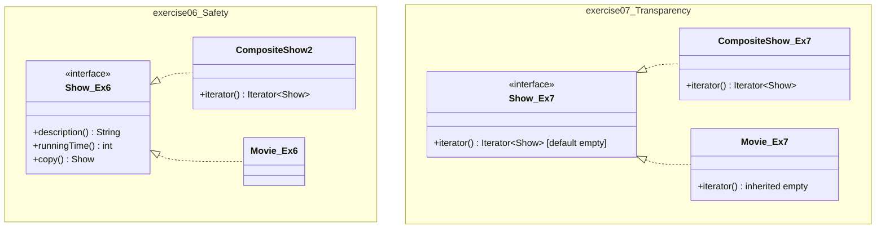

# LAB 07: Unpacking Composite Shows (Safety vs. Transparency)

[](https://www.oracle.com/java/)
[](https://junit.org/junit5/)
[]()
[]()
[]()

> **Dự án thực hành:** Exercise 6.6 & Exercise 6.7  
> **Giáo trình:** *Introduction to Software Design with Java* (Martin P. Robillard, 3rd Edition)  
> **Mục tiêu:** Hiện thực cơ chế "unpack" các show con trong `CompositeShow` bằng `Iterator` theo hai triết lý: **An toàn (Safety)** và **Trong suốt (Transparency)**.

---

## 🚀 Hướng Dẫn Chạy Nhanh (Quick Start)

Dự án đã tích hợp sẵn toàn bộ thư viện JUnit 5 trong thư mục `lib/`, có thể biên dịch và chạy ngay lập tức mà không cần cài đặt thêm Maven hay cấu hình phức tạp:

### Cách 1: Chạy toàn bộ tự động (Build + Test + Demo + Sinh Báo Cáo)
Nhấp đúp chuột vào:
```cmd
build_and_run.bat
```
*(hoặc chạy qua PowerShell: `.\build_and_run.ps1`)*

Kịch bản tự động thực thi 5 tác vụ liên tiếp:
1. `[1/5]` Biên dịch toàn bộ mã nguồn Java với `--release 21`.
2. `[2/5]` Chạy 20 ca kiểm thử tự động qua `TestRunner`.
3. `[3/5]` Chạy demo Bài 6.6 (`Exercise06`).
4. `[4/5]` Chạy demo Bài 6.7 (`Exercise07`).
5. `[5/5]` Chạy chương trình so sánh kiến trúc trực quan (`ComparisonDemo`) và tự động cập nhật báo cáo Word.

### Cách 2: Chạy riêng bộ 20 Unit Tests
```cmd
test.bat
```

### Cách 3: Chạy chương trình đối chứng kiến trúc
```cmd
run.bat
```

### Cách 4: Biên dịch và chạy thủ công bằng lệnh javac / java
```bash
# 1. Biên dịch toàn bộ
javac --release 21 -encoding UTF-8 -cp "lib/*" -d bin src/main/java/designbook/solutions6/**/*.java src/test/java/designbook/solutions6/**/*.java

# 2. Chạy bộ kiểm thử
java -Dfile.encoding=UTF-8 -cp "bin;lib/*" designbook.solutions6.TestRunner

# 3. Chạy demo Bài 6.6 (Safety)
java -Dfile.encoding=UTF-8 -cp "bin;lib/*" designbook.solutions6.exercise06.Exercise06

# 4. Chạy demo Bài 6.7 (Transparency)
java -Dfile.encoding=UTF-8 -cp "bin;lib/*" designbook.solutions6.exercise07.Exercise07

# 5. Chạy chương trình so sánh
java -Dfile.encoding=UTF-8 -cp "bin;lib/*" designbook.solutions6.ComparisonDemo
```

---

## 📁 Cấu Trúc Mã Nguồn và Vai Trò Kỹ Thuật Từng File

Để mã nguồn trong sáng và loại bỏ hoàn toàn sự xung đột định danh lớp (`Show` vs `Show2`, `CompositeShow2` vs `CompositeShow3`), dự án được tổ chức thành 2 package độc lập:

```text
LAB_07/
├── src/main/java/designbook/solutions6/
│   ├── IO.java                                     # Tiện ích in ấn độc lập phiên bản Java
│   ├── ComparisonDemo.java                         # Chương trình chạy đối chứng trực quan 2 giải pháp
│   │
│   ├── exercise06/                                 # === PACKAGE BÀI 6.6: SAFETY APPROACH ===
│   │   ├── Show.java                               # Giao diện gốc (chỉ có description, runningTime, copy)
│   │   ├── Movie.java                              # Nút lá phim điện ảnh (Leaf)
│   │   ├── Concert.java                            # Nút lá buổi hòa nhạc (Leaf)
│   │   ├── CompositeShow.java                      # Composite cơ bản ban đầu (Bài tập 1-5)
│   │   ├── CompositeShow2.java                     # Lớp Composite cài đặt thêm Iterable<Show>
│   │   └── Exercise06.java                         # Demo Client unpack show con bằng 'instanceof'
│   │
│   └── exercise07/                                 # === PACKAGE BÀI 6.7: TRANSPARENCY APPROACH ===
│       ├── Show.java                               # Giao diện Show đã sửa đổi (extends Iterable<Show>)
│       ├── Show2.java                              # Alias kế thừa Show (tương thích tên gọi sách)
│       ├── Movie.java                              # Nút lá Movie (thừa hưởng default empty iterator)
│       ├── Concert.java                            # Nút lá Concert (thừa hưởng default empty iterator)
│       ├── CompositeShow.java                      # Lớp Composite ghi đè iterator() duyệt danh sách con
│       ├── CompositeShow3.java                     # Alias kế thừa CompositeShow (tương thích tên sách)
│       └── Exercise07.java                         # Demo Client duyệt đa hình for-each không cần instanceof
│
├── src/test/java/designbook/solutions6/
│   ├── TestRunner.java                             # Trình điều phối chạy kiểm thử Reflection không cần Maven
│   ├── exercise06/Exercise06Test.java              # 10 ca kiểm thử đơn vị cho Bài 6.6
│   └── exercise07/Exercise07Test.java              # 10 ca kiểm thử đơn vị cho Bài 6.7
│
├── lib/                                            # 6 thư viện JAR JUnit Jupiter 5.10.2 độc lập
├── pom.xml                                         # Cấu hình Maven chuẩn Java 21 LTS
├── build_and_run.bat / build_and_run.ps1           # Kịch bản tự động hóa biên dịch, test và demo
├── test.bat                                        # Phím tắt chạy 20 Unit Tests
├── run.bat                                         # Phím tắt chạy ComparisonDemo
├── generate_docx.py                                # Script Python sinh Báo cáo Word học thuật
├── BAO_CAO_LAB_07_EXERCISE_6_7.docx                # Báo cáo Word hoàn chỉnh 7 Chương
└── README.md                                       # Tài liệu kỹ thuật này
```

---

## ⚡ Tóm Tắt Khác Biệt Cốt Lõi Giữa 2 Hướng Tiếp Cận (TL;DR)



| Đặc tính kỹ thuật | Exercise 6.6 (Safety) | Exercise 6.7 (Transparency) |
| :--- | :--- | :--- |
| **Giao diện `Show`** | Giữ nguyên gốc, không có `iterator()` | Sửa đổi: `extends Iterable<Show>` |
| **Nút lá (`Movie`, `Concert`)** | Không có phương thức `iterator()` | Thừa hưởng `iterator()` trả về rỗng |
| **Mã Client khi duyệt con** | Phải kiểm tra `instanceof CompositeShow2` | Duyệt trực tiếp qua vòng lặp `for-each` |
| **Nguyên lý ISP (Interface Segregation)** | **Tuân thủ nghiêm ngặt** (Giao diện sạch) | **Vi phạm nhẹ** (Nút lá thừa phương thức) |
| **Nguyên lý OCP (Open-Closed)** | Kém linh hoạt (Client phải sửa khi thêm lớp con) | **Tuân thủ tuyệt đối** (Client không đổi) |
| **Nguyên lý LSP (Liskov Substitution)** | An toàn kiểu tại lúc biên dịch | An toàn nhờ Java 8 default empty iterator |
| **Lập trình phòng thủ** | `Collections.unmodifiableList` | `Collections.unmodifiableList` |

---

## 🧪 Chi Tiết Bộ 20 Ca Kiểm Thử Tự Động (Test Suite)

Dự án có đầy đủ **20 ca kiểm thử đơn vị** độc lập được thực thi qua [`TestRunner.java`](file:///d:/MY%20STUDY/HK1_4/THIET_KE/LAB/LAB_07/src/test/java/designbook/solutions6/TestRunner.java):

### 1. Bộ kiểm thử `Exercise06Test` (Gói `exercise06` - 10 Tests)
* `testValidCompositeCreation`: Kiểm tra tạo composite hợp lệ với 2-5 show con và tính đúng tổng thời lượng.
* `testConstructorUnderMinimumShowsThrows`: Bắt lỗi khi truyền < 2 show (`IllegalArgumentException`).
* `testConstructorOverMaximumShowsThrows`: Bắt lỗi khi truyền > 5 show (`IllegalArgumentException`).
* `testConstructorNullShowThrows`: Bắt lỗi khi có show con bị `null` (`IllegalArgumentException`).
* `testIteratorUnpacksAllShowsInOrder`: Kiểm tra lấy các show con qua iterator đúng thứ tự ban đầu.
* `testIteratorIsUnmodifiable`: Kiểm tra ném `UnsupportedOperationException` khi gọi `iterator.remove()`.
* `testNestedCompositeUnpacking`: Kiểm tra unpack cấu trúc composite lồng nhau đa tầng.
* `testDescriptionFormatting`: Kiểm tra định dạng chuỗi mô tả `[show1; show2; ...]`.
* `testEqualsAndHashCode`: Kiểm tra tính toàn vẹn của `equals` và `hashCode`.
* `testDeepCopy`: Kiểm tra tính độc lập của phép nhân bản sâu (`copy()`).

### 2. Bộ kiểm thử `Exercise07Test` (Gói `exercise07` - 10 Tests)
* `testValidCompositeCreation`: Kiểm tra tạo composite hợp lệ.
* `testConstructorUnderMinimumShowsThrows`: Bắt lỗi khi truyền < 2 show.
* `testConstructorOverMaximumShowsThrows`: Bắt lỗi khi truyền > 5 show.
* `testConstructorNullShowThrows`: Bắt lỗi khi có show con bị `null`.
* `testPolymorphicIterationOnCompositeWithoutInstanceof`: Kiểm tra duyệt trực tiếp bằng vòng lặp `for-each` trên biến kiểu `Show` không cần `instanceof`.
* `testPolymorphicIterationOnLeafNodeYieldsEmptyIterator`: Kiểm tra duyệt `for-each` trên nút lá `Movie` chạy đúng 0 lần an toàn.
* `testIteratorIsUnmodifiable`: Kiểm tra iterator ném `UnsupportedOperationException` khi gọi `remove()`.
* `testNestedCompositePolymorphicUnpacking`: Kiểm tra duyệt đa hình trên composite lồng nhau.
* `testPureRecursiveFlatteningWithoutAnyInstanceof`: Kiểm tra thuật toán đệ quy gom nút lá thuần đa hình.
* `testDeepCopy`: Kiểm tra phép nhân bản sâu trên cấu trúc Show đã sửa đổi.

---

## 📄 Tài Liệu Báo Cáo Đính Kèm (Deliverables)

* [**`BAO_CAO_LAB_07_EXERCISE_6_7.docx`**](file:///d:/MY%20STUDY/HK1_4/THIET_KE/LAB/LAB_07/BAO_CAO_LAB_07_EXERCISE_6_7.docx): Báo cáo Word học thuật 7 Chương hoàn chỉnh để nộp bài (chuẩn font Times New Roman, phân tích kiến trúc, trích dẫn mã nguồn và log thực nghiệm).
* [**`generate_docx.py`**](file:///d:/MY%20STUDY/HK1_4/THIET_KE/LAB/LAB_07/generate_docx.py): Script Python sử dụng thư viện `python-docx` để tự động tạo lại báo cáo Word khi cần.
