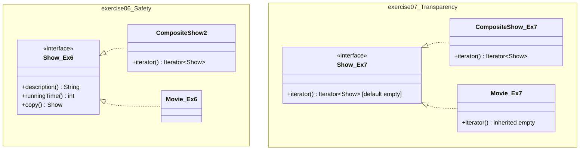

# LAB 07: Thao Tác Unpack Trong Composite Pattern (Safety vs. Transparency)

[](https://www.oracle.com/java/)
[](https://junit.org/junit5/)
[]()
[]()
[]()

> **Bài tập:** Exercise 6.6 & Exercise 6.7 (Chương 6 - Composite Pattern & Iterator Pattern)  
> **Giáo trình:** *Introduction to Software Design with Java* (Martin P. Robillard, 3rd Edition)  
> **Mục tiêu:** Hiện thực cơ chế "unpack" các show con trong `CompositeShow` bằng `Iterator` theo hai triết lý: **An toàn (Safety)** và **Trong suốt (Transparency)**.

---

## 🚀 Hướng Dẫn Chạy Nhanh (Quick Start)

Dự án tích hợp sẵn toàn bộ thư viện JUnit 5 trong thư mục `lib/`, có thể biên dịch và chạy ngay lập tức mà không cần cài đặt thêm phần mềm phụ trợ:

### Cách 1: Chạy toàn bộ tự động (Biên dịch + 20 Tests + Demo + Báo cáo)
Nhấp đúp chuột hoặc chạy từ cửa sổ dòng lệnh:
```cmd
build_and_run.bat
```
*(hoặc chạy qua PowerShell: `.\build_and_run.ps1`)*

### Cách 2: Chạy riêng bộ 20 Unit Tests
```cmd
test.bat
```

### Cách 3: Chạy chương trình so sánh kiến trúc trực quan
```cmd
run.bat
```

### Cách 4: Dòng lệnh thủ công javac / java
```bash
# 1. Biên dịch toàn bộ mã nguồn và kiểm thử
javac --release 21 -encoding UTF-8 -cp "lib/*" -d bin src/main/java/designbook/solutions6/**/*.java src/test/java/designbook/solutions6/**/*.java

# 2. Chạy bộ kiểm thử tự động
java -Dfile.encoding=UTF-8 -cp "bin;lib/*" designbook.solutions6.TestRunner

# 3. Chạy demo Bài 6.6 (Safety Approach)
java -Dfile.encoding=UTF-8 -cp "bin;lib/*" designbook.solutions6.exercise06.Exercise06

# 4. Chạy demo Bài 6.7 (Transparency Approach)
java -Dfile.encoding=UTF-8 -cp "bin;lib/*" designbook.solutions6.exercise07.Exercise07

# 5. Chạy chương trình so sánh đối chứng
java -Dfile.encoding=UTF-8 -cp "bin;lib/*" designbook.solutions6.ComparisonDemo
```

---

## 📝 Danh Sách Các File Sửa Đổi & Thêm Mới Trong Bài Tập

Hệ thống biểu diễn nhà hát cơ sở (xây dựng từ Bài tập 6.1 đến 6.5) gồm có:
* `Show.java`: Giao diện Component với 3 phương thức `description()`, `runningTime()`, `copy()`.
* `Movie.java`, `Concert.java`: Các lớp nút lá Leaf.
* `CompositeShow.java`: Lớp phức hợp Composite cơ bản chứa từ 2 đến 5 show con.

Để thực hiện trọn vẹn yêu cầu **Exercise 6.6** (unpack không sửa `Show`) và **Exercise 6.7** (unpack bằng cách sửa `Show`), dự án đã phân chia thành 2 package con và thực hiện các thay đổi/thêm mới cụ thể như sau:

### 1. File SỬA ĐỔI (Modified File)

* **`src/main/java/designbook/solutions6/exercise07/Show.java`**
  * **Vai trò:** Giao diện Component cơ sở được sửa đổi theo yêu cầu của **Exercise 6.7** (*"by modifying the Show interface"*).
  * **Nội dung sửa đổi:**
    1. **Mở rộng `Iterable<Show>`:** Khai báo `public interface Show extends Iterable<Show>` cho phép mọi đối tượng Show đều có thể đặt vào vòng lặp `for-each`.
    2. **Tích hợp Java 8 Default Method:** Bổ sung phương thức mặc định:
       ```java
       @Override
       default Iterator<Show> iterator() {
           return Collections.emptyIterator();
       }
       ```
       *Ý nghĩa:* Giúp các nút lá (`Movie`, `Concert`) tự động thừa hưởng bộ lặp rỗng mà không cần phải tự cài đặt hay ném ngoại lệ `UnsupportedOperationException`, tránh vi phạm nguyên lý Liskov Substitution (LSP) và an toàn tuyệt đối khi Client lặp qua nút lá (chạy đúng 0 lần).

---

### 2. Các File THÊM MỚI (Added Files)

#### A. Mã nguồn cho Bài tập Exercise 6.6 (Gói `exercise06` – Safety Approach)
* **`src/main/java/designbook/solutions6/exercise06/CompositeShow2.java`**
  * **Vai trò:** Hiện thực giải pháp cốt lõi cho Bài tập 6.6 theo hướng tiếp cận An toàn (Safety).
  * **Kỹ thuật áp dụng:**
    * Giữ nguyên giao diện `Show` gốc không đổi.
    * Khai báo cài đặt thêm `Iterable<Show>`: `public class CompositeShow2 implements Show, Iterable<Show>`.
    * **Lập trình phòng thủ (Defensive Programming):** Trả về `Collections.unmodifiableList(aShows).iterator()` để bảo vệ tính bất biến, chặn đứng hành vi gọi `iterator.remove()` làm biến đổi danh sách show con.
* **`src/main/java/designbook/solutions6/exercise06/Exercise06.java`**
  * **Vai trò:** Lớp Client Demo Bài 6.6. Minh họa cách unpack show con, chứng minh phía Client bắt buộc phải kiểm tra kiểu bằng `if (show instanceof CompositeShow2 compositeShow)` trước khi duyệt.
* **`src/test/java/designbook/solutions6/exercise06/Exercise06Test.java`**
  * **Vai trò:** Bộ kiểm thử đơn vị gồm **10 ca test** cho Bài 6.6 (kiểm tra ràng buộc 2-5 show, show null, deep copy, tính bất biến khi remove, unpack cây lồng nhau).

#### B. Mã nguồn cho Bài tập Exercise 6.7 (Gói `exercise07` – Transparency Approach)
* **`src/main/java/designbook/solutions6/exercise07/CompositeShow.java`**
  * **Vai trò:** Hiện thực giải pháp cốt lõi cho Bài tập 6.7 theo hướng tiếp cận Trong suốt (Transparency).
  * **Kỹ thuật áp dụng:**
    * Cài đặt giao diện `Show` đã sửa đổi: `public class CompositeShow implements Show`.
    * Ghi đè phương thức `iterator()` trả về `Collections.unmodifiableList(aShows).iterator()`.
* **`src/main/java/designbook/solutions6/exercise07/Exercise07.java`**
  * **Vai trò:** Lớp Client Demo Bài 6.7. Minh họa duyệt đa hình thuần túy qua `for-each` **hoàn toàn không cần `instanceof`**; kiểm chứng duyệt an toàn trên nút lá `Movie` chạy đúng 0 lần.
* **`src/main/java/designbook/solutions6/exercise07/Show2.java` & `CompositeShow3.java`**
  * **Vai trò:** Các lớp Alias kế thừa (`Show2 extends Show`, `CompositeShow3 extends CompositeShow`) nhằm đảm bảo tương thích 100% với tên gọi trong lời giải mẫu của giáo trình nếu bài thi yêu cầu đúng tên đó.
* **`src/test/java/designbook/solutions6/exercise07/Exercise07Test.java`**
  * **Vai trò:** Bộ kiểm thử đơn vị gồm **10 ca test** cho Bài 6.7 (duyệt đa hình không cần `instanceof`, duyệt nút lá trả về `emptyIterator`, làm phẳng cây đệ quy thuần đa hình).

#### C. Các thành phần Hỗ trợ & Đối chứng (Shared & Infrastructure)
* **`src/main/java/designbook/solutions6/ComparisonDemo.java`**
  * **Vai trò:** Chương trình độc lập so sánh trực quan cả 2 cách làm song song trên cùng một cấu trúc cây phức tạp, kiểm tra tính bất biến và in bảng ma trận so sánh SOLID.
* **`src/main/java/designbook/solutions6/IO.java`**
  * **Vai trò:** Tiện ích in ấn tương thích mọi phiên bản Java (từ Java 8 đến Java 25+).
* **`src/test/java/designbook/solutions6/TestRunner.java`**
  * **Vai trò:** Trình chạy test tự động xây dựng bằng Java Reflection API, quét và thực thi toàn bộ 20 tests mà không phụ thuộc IDE hay Maven.
* **`lib/`**: 6 JAR files JUnit 5.10.2 (API, Engine, Platform Commons, Platform Engine, OpenTest4j, APIGuardian).
* **`pom.xml`**: Cấu hình Maven chuẩn Java 21 LTS (`maven-compiler-plugin`, `maven-surefire-plugin`).
* **`build_and_run.bat` / `.ps1` / `test.bat` / `run.bat`**: Các kịch bản tự động hóa biên dịch và thực thi trên Windows.
* **`BAO_CAO_LAB_07_EXERCISE_6_7.docx`**: Báo cáo học thuật 7 Chương hoàn chỉnh để nộp bài.

---

## 📁 Cấu Trúc Thư Mục Dự Án (Project Layout)

```text
LAB_07/
├── lib/                                                # Bộ thư viện JUnit Jupiter 5.10.2 độc lập
│   ├── apiguardian-api-1.1.2.jar
│   ├── junit-jupiter-api-5.10.2.jar
│   ├── junit-jupiter-engine-5.10.2.jar
│   ├── junit-platform-commons-1.10.2.jar
│   ├── junit-platform-engine-1.10.2.jar
│   └── opentest4j-1.2.0.jar
│
├── src/
│   ├── main/java/designbook/solutions6/
│   │   ├── IO.java                                     # [THÊM MỚI] Tiện ích in ấn tương thích mọi Java
│   │   ├── ComparisonDemo.java                         # [THÊM MỚI] Chương trình chạy đối chứng 2 giải pháp
│   │   │
│   │   ├── exercise06/                                 # === BÀI TẬP 6.6: SAFETY APPROACH ===
│   │   │   ├── Show.java                               # Interface gốc giữ nguyên (không có iterator)
│   │   │   ├── Movie.java                              # Nút lá Movie sạch sẽ
│   │   │   ├── Concert.java                            # Nút lá Concert sạch sẽ
│   │   │   ├── CompositeShow.java                      # Composite cơ sở (từ Exercise 1-5)
│   │   │   ├── CompositeShow2.java                     # [THÊM MỚI] Lời giải Bài 6.6 (implements Iterable<Show>)
│   │   │   └── Exercise06.java                         # [THÊM MỚI] Client demo unpack bằng 'instanceof'
│   │   │
│   │   └── exercise07/                                 # === BÀI TẬP 6.7: TRANSPARENCY APPROACH ===
│   │       ├── Show.java                               # [SỬA ĐỔI] Interface kế thừa Iterable<Show> + default method
│   │       ├── Show2.java                              # [THÊM MỚI] Alias tương thích tên gọi giáo trình
│   │       ├── Movie.java                              # Nút lá Movie (thừa hưởng default empty iterator)
│   │       ├── Concert.java                            # Nút lá Concert (thừa hưởng default empty iterator)
│   │       ├── CompositeShow.java                      # [THÊM MỚI] Lời giải Bài 6.7 (ghi đè iterator() duyệt con)
│   │       ├── CompositeShow3.java                     # [THÊM MỚI] Alias tương thích tên gọi giáo trình
│   │       └── Exercise07.java                         # [THÊM MỚI] Client demo duyệt đa hình không cần instanceof
│   │
│   └── test/java/designbook/solutions6/
│       ├── TestRunner.java                             # [THÊM MỚI] Trình chạy 20 Unit Tests bằng Reflection
│       ├── exercise06/Exercise06Test.java              # [THÊM MỚI] 10 ca kiểm thử đơn vị cho Bài 6.6
│       └── exercise07/Exercise07Test.java              # [THÊM MỚI] 10 ca kiểm thử đơn vị cho Bài 6.7
│
├── pom.xml                                             # [THÊM MỚI] Cấu hình Maven chuẩn Java 21 LTS
├── test.bat                                            # [THÊM MỚI] Script 1-click chạy TestRunner
├── run.bat                                             # [THÊM MỚI] Script 1-click chạy ComparisonDemo
├── build_and_run.bat / .ps1                            # [THÊM MỚI] Script biên dịch và chạy toàn diện
├── README.md                                           # Hướng dẫn kỹ thuật và danh mục dự án
└── BAO_CAO_LAB_07_EXERCISE_6_7.docx                     # Báo cáo học thuật 7 Chương hoàn chỉnh
```

---

## ⚡ So Sánh Kỹ Thuật Giữa Hai Cách Tiếp Cận



| Đặc tính kỹ thuật | Exercise 6.6 (Safety Approach) | Exercise 6.7 (Transparency Approach) |
| :--- | :--- | :--- |
| **Giao diện `Show`** | Giữ nguyên gốc, không có `iterator()` | Sửa đổi: `extends Iterable<Show>` |
| **Nút lá (`Movie`, `Concert`)** | Không có phương thức `iterator()` | Thừa hưởng `iterator()` (trả về rỗng) |
| **Mã Client khi duyệt con** | Phải kiểm tra `instanceof CompositeShow2` | Duyệt trực tiếp qua vòng lặp `for-each` |
| **Nguyên lý ISP (Interface Segregation)** | **Tuân thủ nghiêm ngặt** (Giao diện sạch) | **Vi phạm nhẹ** (Nút lá thừa phương thức) |
| **Nguyên lý OCP (Open-Closed)** | Kém linh hoạt (Client phải sửa khi thêm lớp con) | **Tuân thủ tuyệt đối** (Client không đổi) |
| **Nguyên lý LSP (Liskov Substitution)** | An toàn kiểu tại lúc biên dịch | An toàn nhờ Java 8 default empty iterator |
| **Lập trình phòng thủ** | `Collections.unmodifiableList` | `Collections.unmodifiableList` |

---

## 🧪 Kết Quả Thực Thi Bộ 20 Ca Kiểm Thử Tự Động

Toàn bộ **20/20 Test Cases** được điều phối qua [`TestRunner.java`](file:///d:/MY%20STUDY/HK1_4/THIET_KE/LAB/LAB_07/src/test/java/designbook/solutions6/TestRunner.java) và vượt qua 100%:

```text
================================================================================
            RUNNING AUTOMATED UNIT TESTS FOR LAB_07 (EXERCISES 6 & 7)           
       Composite Pattern: Safety (Ex 6.6) vs Transparency (Ex 6.7)              
================================================================================

[TEST SUITE] Exercise06Test (Safety Approach - Giao diện Show giữ nguyên)
  [PASS] testConstructorNullShowThrows
  [PASS] testConstructorOverMaximumShowsThrows
  [PASS] testConstructorUnderMinimumShowsThrows
  [PASS] testDeepCopy
  [PASS] testDescriptionFormatting
  [PASS] testEqualsAndHashCode
  [PASS] testIteratorIsUnmodifiable
  [PASS] testIteratorUnpacksAllShowsInOrder
  [PASS] testNestedCompositeUnpacking
  [PASS] testValidCompositeCreation

[TEST SUITE] Exercise07Test (Transparency Approach - Giao diện Show đã sửa đổi)
  [PASS] testConstructorNullShowThrows
  [PASS] testConstructorOverMaximumShowsThrows
  [PASS] testConstructorUnderMinimumShowsThrows
  [PASS] testDeepCopy
  [PASS] testIteratorIsUnmodifiable
  [PASS] testNestedCompositePolymorphicUnpacking
  [PASS] testPolymorphicIterationOnCompositeWithoutInstanceof
  [PASS] testPolymorphicIterationOnLeafNodeYieldsEmptyIterator
  [PASS] testPureRecursiveFlatteningWithoutAnyInstanceof
  [PASS] testValidCompositeCreation
--------------------------------------------------------------------------------
OVERALL RESULTS: 20 PASSED, 0 FAILED, TOTAL TESTS: 20
================================================================================
```

---

## 📄 Tài Liệu Báo Cáo Đính Kèm

* [**`BAO_CAO_LAB_07_EXERCISE_6_7.docx`**](file:///d:/MY%20STUDY/HK1_4/THIET_KE/LAB/LAB_07/BAO_CAO_LAB_07_EXERCISE_6_7.docx): Báo cáo Word học thuật 7 Chương hoàn chỉnh để nộp bài (chuẩn font Times New Roman, phân tích kiến trúc, trích dẫn mã nguồn và log thực nghiệm).
