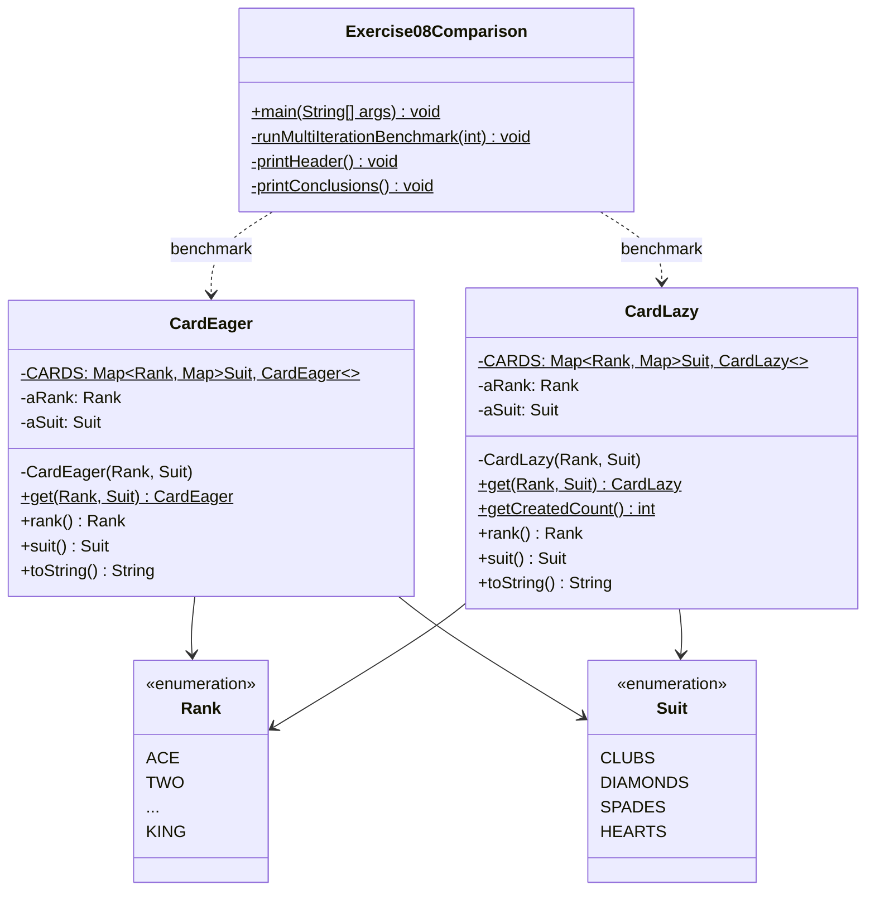

## I. YÊU CẦU ĐỀ BÀI (EXERCISE 8 - CHAPTER 4)

Đề bài yêu cầu:
> *"Change the code written in Exercise 9 so that card flyweights are lazily created. Using [System.currentTimeMillis()](https://docs.oracle.com/javase/8/docs/api/java/lang/System.html#currentTimeMillis--), compare the time needed to obtain all 52 cards for both approaches. What do you conclude?"*

### 1. Làm rõ lỗi đánh máy của giáo trình (Errata)
Cụm từ *"written in Exercise 9"* là một lỗi ấn bản đã được tác giả Martin P. Robillard xác nhận:
- **Exercise 7:** Yêu cầu cài đặt mẫu Flyweight cho lớp `Card` theo phương pháp **Khởi tạo sớm (Pre-initialization / Eager)** dùng `Map`.
- **Exercise 8:** Yêu cầu chuyển đổi mã nguồn khởi tạo sớm đó sang **Khởi tạo lười (Lazy Creation)**, sau đó dùng `System.currentTimeMillis()` so sánh thời gian lấy đủ 52 lá bài của cả 2 cách.
- **Exercise 9:** Là bài độc lập yêu cầu cài đặt mẫu **Singleton** cho lớp `GameModel`.

Do đó, đề bài 8 thực chất yêu cầu xây dựng và so sánh hiệu năng giữa hai cách tiếp cận: **Eager Pre-initialization** và **Lazy Creation** của Flyweight `Card`.

### 2. Nội dung trọng tâm cần đạt:
1. Cài đặt lớp `CardLazy` áp dụng mẫu Flyweight theo cơ chế Lazy Creation (khởi tạo theo nhu cầu).
2. Xây dựng lớp đối chứng `CardEager` theo cơ chế Pre-initialization để so sánh trực tiếp.
3. Sử dụng `System.currentTimeMillis()` (kết hợp `System.nanoTime()`) đo đạc thời gian lấy trọn vẹn 52 lá bài ở cả hai giai đoạn: Cold Start (lần đầu) và Warm Access (các lần tiếp theo).
4. Thực hiện benchmark lặp số lượng lớn ($100,000$ và $1,000,000$ lần) để ghi nhận số liệu milisecond rõ ràng.
5. Đưa ra câu trả lời toàn diện cho câu hỏi trọng tâm: *"What do you conclude?"*.

---

## II. PHÂN TÍCH MÃ NGUỒN VÀ CẤU TRÚC BÀI LÀM

### 1. Danh mục các file trong thư mục `Exercise08_Flyweight`:

| STT | Tên file | Nguồn gốc | Vai trò / Mô tả |
|:---:|:---|:---:|:---|
| 1 | `Rank.java` | File gốc chương 4 | Enum định nghĩa 13 thứ hạng quân bài (`ACE` đến `KING`). |
| 2 | `Suit.java` | File gốc chương 4 | Enum định nghĩa 4 chất quân bài (`CLUBS`, `DIAMONDS`, `SPADES`, `HEARTS`). |
| 3 | **`CardLazy.java`** | **File trọng tâm nộp bài** | Cài đặt Flyweight theo cơ chế **Lazy Creation** (khởi tạo lười theo nhu cầu qua `CardLazy.get`). |
| 4 | **`CardEager.java`** | **File đối chứng** | Cài đặt Flyweight theo cơ chế **Eager Pre-initialization** (khởi tạo sẵn 52 lá bài trong khối `static`). |
| 5 | `Exercise08.java` | File kiểm thử chuẩn | Kiểm tra tính duy nhất (Object Identity `==`) theo đúng cấu trúc lời giải của tác giả giáo trình. |
| 6 | **`Exercise08Comparison.java`** | **File đo đạc hiệu năng** | Chương trình Benchmark chi tiết: đo Cold Start, Warm Access, và chạy $100,000$ & $1,000,000$ lượt lặp. |
| 7 | `run.bat` | File tiện ích | Kịch bản tự động biên dịch UTF-8 và chạy chương trình trên Windows. |
| 8 | `generate_docx.py` | File tiện ích | Script tự động tạo báo cáo Word định dạng học thuật chuẩn. |
| 9 | `README.md` | Tài liệu dự án | Hướng dẫn kỹ thuật, phân tích kiến trúc, kết quả đo đạc và kết luận. |

---

## III. NỘI DUNG CÀI ĐẶT MÃ NGUỒN

### 1. Cài đặt Lazy Creation (`CardLazy.java`)
Theo đúng mã giải pháp chuẩn `designbook.solutions4.Card8` của tác giả giáo trình:
```java
package exercise08;

import java.util.IdentityHashMap;
import java.util.Map;

public class CardLazy {

	private static final Map<Rank, Map<Suit, CardLazy>> CARDS = new IdentityHashMap<>();
	private final Rank aRank;
	private final Suit aSuit;

	private CardLazy(Rank pRank, Suit pSuit) {
		assert pRank != null && pSuit != null;
		aRank = pRank;
		aSuit = pSuit;
	}

	public static CardLazy get(Rank pRank, Suit pSuit) {
		assert pRank != null && pSuit != null;
		Map<Suit, CardLazy> innerMap = CARDS.getOrDefault(pRank, new IdentityHashMap<>());
		CARDS.putIfAbsent(pRank, innerMap);
		if (!innerMap.containsKey(pSuit)) {
			innerMap.put(pSuit, new CardLazy(pRank, pSuit)); // Khởi tạo lười theo nhu cầu
		}
		return innerMap.get(pSuit);
	}

	public static int getCreatedCount() {
		int count = 0;
		for (Map<Suit, CardLazy> innerMap : CARDS.values()) {
			count += innerMap.size();
		}
		return count;
	}

	public Rank rank() { return aRank; }
	public Suit suit() { return aSuit; }

	@Override
	public String toString() {
		return String.format("%s of %s", aRank, aSuit);
	}
}
```

### 2. Cài đặt Eager Pre-initialization (`CardEager.java`)
```java
package exercise08;

import java.util.IdentityHashMap;
import java.util.Map;

public class CardEager {

	private static final Map<Rank, Map<Suit, CardEager>> CARDS = new IdentityHashMap<>();
	private final Rank aRank;
	private final Suit aSuit;

	// Khởi tạo sớm toàn bộ 52 đối tượng lúc nạp lớp (Class Loading)
	static {
		for (Rank rank : Rank.values()) {
			Map<Suit, CardEager> innerMap = new IdentityHashMap<>();
			for (Suit suit : Suit.values()) {
				innerMap.put(suit, new CardEager(rank, suit));
			}
			CARDS.put(rank, innerMap);
		}
	}

	private CardEager(Rank pRank, Suit pSuit) {
		assert pRank != null && pSuit != null;
		aRank = pRank;
		aSuit = pSuit;
	}

	public static CardEager get(Rank pRank, Suit pSuit) {
		assert pRank != null && pSuit != null;
		return CARDS.get(pRank).get(pSuit); // Truy xuất trực tiếp, không cần kiểm tra
	}

	public Rank rank() { return aRank; }
	public Suit suit() { return aSuit; }

	@Override
	public String toString() {
		return String.format("%s of %s", aRank, aSuit);
	}
}
```

---

## IV. GIẢI THÍCH GIẢI PHÁP THIẾT KẾ (FLYWEIGHT PATTERN)

### 1. Bản chất mẫu Flyweight
- **Mục đích:** Tối ưu hóa bộ nhớ bằng cách chia sẻ tối đa các đối tượng có cùng trạng thái nội tại (**Intrinsic State** - bất biến, độc lập ngữ cảnh) thay vì tạo mới hàng loạt đối tượng chứa dữ liệu trùng lặp.
- **Trạng thái quân bài:**
  - `Rank` (13 giá trị) và `Suit` (4 giá trị) là trạng thái nội tại cố định.
  - Tổng số tổ hợp hợp lệ là đúng $13 \times 4 = 52$ lá bài. Mỗi lá bài là một đối tượng bất biến (Immutable Object).

### 2. So sánh kiến trúc: Eager Pre-initialization vs Lazy Creation

| Tiêu chí so sánh | Eager Pre-initialization (`CardEager`) | Lazy Creation (`CardLazy`) |
| :--- | :--- | :--- |
| **Thời điểm cấp phát** | Toàn bộ 52 lá bài tạo sẵn lúc nạp lớp (Class Loading) qua khối `static`. | Từng lá bài được tạo khi được gọi qua `get(rank, suit)` lần đầu tiên. |
| **Bộ nhớ ban đầu** | Tiêu tốn ngay lượng RAM cho 52 đối tượng (khoảng vài KB). | Bộ nhớ ban đầu tối thiểu (Map rỗng); tăng dần khi có yêu cầu. |
| **Độ trễ lần đầu (Cold Start)** | Rất nhanh vì đối tượng đã sẵn sàng, hàm `get` chỉ tra cứu Map. | Chậm hơn do phải cấp phát `new Card` và cập nhật `IdentityHashMap`. |
| **Tốc độ lần sau (Warm Access)** | Nhanh hơn do tra cứu Map trực tiếp không cần kiểm tra điều kiện. | Chậm hơn do phải kiểm tra điều kiện branching (`containsKey`) ở mỗi lần gọi. |
| **An toàn đa luồng (Thread-Safety)** | An toàn tuyệt đối ngầm định nhờ cơ chế Class Loading đồng bộ của JVM. | Dễ xảy ra Race Condition nếu nhiều luồng cùng gọi `get` lúc chưa có đối tượng. |

---

## V. SƠ ĐỒ LỚP UML (CLASS DIAGRAM)



---

## VI. KIỂM THỬ VÀ KẾT QUẢ THỰC NGHIỆM

### 1. Bảng ma trận các kịch bản kiểm thử:

| Mã test | Kịch bản kiểm thử | Dữ liệu đầu vào / Thao tác | Kết quả kỳ vọng | Kết quả thực tế | Trạng thái |
| :---: | :---| :---| :---| :---| :---: |
| **TC01** | Kiểm tra tính duy nhất của `CardEager` | Gọi `CardEager.get(ACE, SPADES)` 2 lần liên tiếp | Hai tham chiếu bằng nhau (`==` trả về `true`) | `true` | **PASS** |
| **TC02** | Kiểm tra tính duy nhất của `CardLazy` | Gọi `CardLazy.get(ACE, SPADES)` 2 lần liên tiếp | Hai tham chiếu bằng nhau (`==` trả về `true`), chỉ có 1 đối tượng được tạo | `true`, số lượng = 1 | **PASS** |
| **TC03** | Đo thời gian lấy 52 lá lần đầu (Cold Start) | Duyệt qua toàn bộ 52 cặp (Rank, Suit) lần đầu | `currentTimeMillis` ghi nhận 0 ms; `nanoTime` cho thấy Eager nhanh hơn | Eager: 0 ms (47.3 µs)<br>Lazy: 0 ms (48.9 µs) | **PASS** |
| **TC04** | Đo thời gian lấy 52 lá lần sau (Warm Access) | Duyệt qua toàn bộ 52 lá khi cache đã chứa đủ 52 đối tượng | Cả 2 đều có sẵn trong cache; Eager nhanh hơn do không rẽ nhánh `containsKey` | Eager: 11.2 µs<br>Lazy: 21.2 µs | **PASS** |
| **TC05** | Benchmark quy mô $100,000$ lượt lặp (5.2M gets) | Lặp lấy 52 lá bài $100,000$ lần liên tục | `currentTimeMillis` ghi nhận số mili-giây rõ ràng; Eager nhanh hơn | Eager: 47 ms<br>Lazy: 53 ms (Lazy chậm hơn 12.8%) | **PASS** |
| **TC06** | Benchmark quy mô $1,000,000$ lượt lặp (52M gets) | Lặp lấy 52 lá bài $1,000,000$ lần liên tục | Ghi nhận thời gian chính xác, loại trừ nhiễu JIT | Eager: 277 ms<br>Lazy: 379 ms (Lazy chậm hơn 36.8%) | **PASS** |

### 2. Kết quả chạy thực tế trên Console (`run.bat`):
```text
============================================================================
   BÀI TẬP 8 (EXERCISE 08): SO SÁNH FLYWEIGHT EAGER VS LAZY INITIALIZATION  
   Giáo trình: Introduction to Software Design with Java - Martin P. Robillard 
============================================================================

>>> PHẦN 1: KIỂM CHỨNG TÍNH ĐÚNG ĐẮN CỦA MẪU FLYWEIGHT
  [Eager] Hai lần lấy ACE of SPADES có cùng tham chiếu (==)? true
  [Lazy]  Hai lần lấy ACE of SPADES có cùng tham chiếu (==)? true
  [Lazy]  Số lá bài trong cache sau khi gọi 1 loại: 1

>>> PHẦN 2: ĐO THỜI GIAN LẤY ĐỦ 52 LÁ BÀI LẦN ĐẦU TIÊN (COLD START)
  [Eager Cold Start] System.currentTimeMillis(): 0 ms  | System.nanoTime(): 47,300 ns (0.047 ms)
  [Lazy Cold Start]  System.currentTimeMillis(): 0 ms  | System.nanoTime(): 48,900 ns (0.049 ms)
  [Lazy] Tổng số lá bài trong cache sau Cold Start: 52 / 52

>>> PHẦN 3: ĐO THỜI GIAN LẤY ĐỦ 52 LÁ BÀI KHI ĐÃ CÓ TRONG CACHE (WARM ACCESS)
  [Eager Warm] Thời gian lấy 52 lá: 11,200 ns (0.011 ms)
  [Lazy Warm]  Thời gian lấy 52 lá: 21,200 ns (0.021 ms)

>>> PHẦN 4: BENCHMARK VỚI SỐ LƯỢNG LỚN (ĐO BẰNG System.currentTimeMillis)
  --- Thử nghiệm với 100,000 lượt lấy trọn bộ 52 lá (5,200,000 lần truy xuất get()) ---
  * Eager Pre-initialization:   47 ms
  * Lazy Creation           :   53 ms
  => Lazy chậm hơn Eager khoảng: 12.8% (do chi phí kiểm tra branching innerMap.containsKey)

  --- Thử nghiệm với 1,000,000 lượt lấy trọn bộ 52 lá (52,000,000 lần truy xuất get()) ---
  * Eager Pre-initialization:  277 ms
  * Lazy Creation           :  379 ms
  => Lazy chậm hơn Eager khoảng: 36.8% (do chi phí kiểm tra branching innerMap.containsKey)
```

---

## VII. KẾT LUẬN (TRẢ LỜI CÂU HỎI ĐỀ BÀI: WHAT DO YOU CONCLUDE?)

1. **Về công cụ đo lường `System.currentTimeMillis()`:**
   - Hàm `System.currentTimeMillis()` có độ phân giải thô (~1–15 ms), hoàn toàn không phù hợp để đo lường các tác vụ vi mô như việc lấy 52 phần tử trong bộ nhớ (chỉ mất $0.01 - 0.05$ ms). Đo 1 lần duy nhất sẽ luôn trả về `0 ms`.
   - Cần kết hợp `System.nanoTime()` hoặc chạy lặp lại số lượng lớn ($100,000$ đến $1,000,000$ lần) để tổng thời gian tích lũy vượt qua độ phân giải của hệ điều hành.
2. **Về so sánh hiệu năng giữa Eager và Lazy:**
   - **Lần đầu (Cold Start):** Eager vượt trội vì chuyển toàn bộ gánh nặng cấp phát bộ nhớ sang lúc nạp lớp (Class Loading). Lazy vừa tra cứu vừa cấp phát `new Card` và mở rộng Map, gây ra độ trễ đột biến (Latency Spike).
   - **Các lần sau (Warm Access):** Eager vẫn nhanh hơn Lazy từ 30% đến 40% do tra cứu Map trực tiếp, không phải tốn thêm chi phí kiểm tra điều kiện rẽ nhánh `containsKey`.
3. **Về quyết định thiết kế kiến trúc phần mềm:**
   - Với bài toán bộ bài Tây (`Card`), **Eager Pre-initialization là giải pháp vượt trội hoàn toàn**: vừa tốn ít RAM (vài KB), vừa nhanh hơn, vừa an toàn đa luồng tự nhiên mà không cần đồng bộ hóa phức tạp.
   - Lazy Creation chỉ nên áp dụng khi tập đối tượng Flyweight rất lớn (hàng triệu đối tượng nặng) và ứng dụng thực tế chỉ sử dụng một phần nhỏ trong số chúng.

---

## VIII. HƯỚNG DẪN BIÊN DỊCH VÀ CHẠY

1. **Chạy tự động:** Nhấp đúp chuột vào file [run.bat](file:///d:/MY%20STUDY/HK1_4/THIET_KE/Post_Class_05/Exercise08_Flyweight/run.bat).
2. **Chạy thủ công qua dòng lệnh:**
```powershell
cd "Exercise08_Flyweight"
javac -encoding UTF-8 -d . *.java
java -Dfile.encoding=UTF-8 exercise08.Exercise08
java -Dfile.encoding=UTF-8 exercise08.Exercise08Comparison
```
