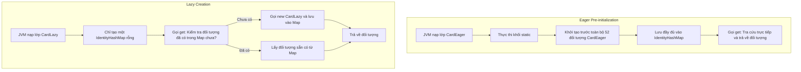
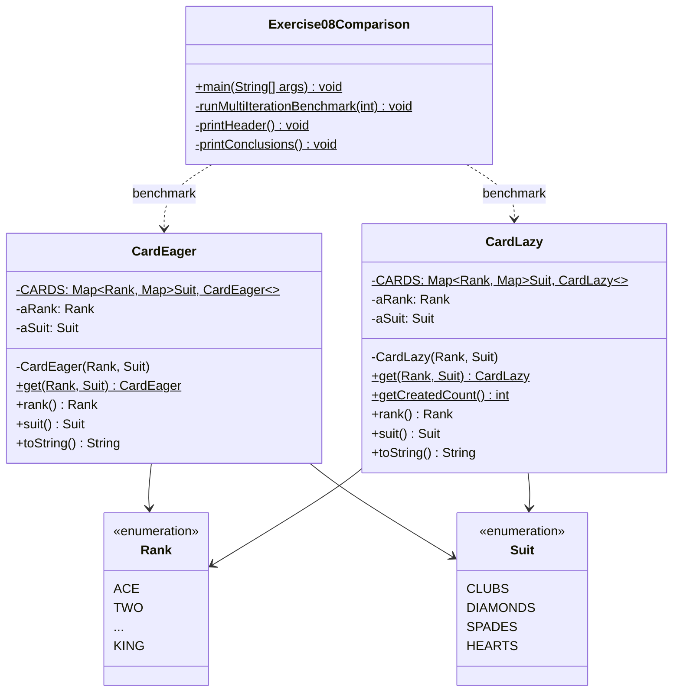

# TRƯỜNG ĐẠI HỌC CÔNG NGHỆ THÔNG TIN – ĐHQG-HCM
## KHOA CÔNG NGHỆ PHẦN MỀM

---

# BÁO CÁO BÀI TẬP THỰC HÀNH THIẾT KẾ PHẦN MỀM
### BÀI TẬP 08 (CHAPTER 4): HIỆN THỰC VÀ ĐO LƯỜNG HIỆU NĂNG MẪU THIẾT KẾ FLYWEIGHT (EAGER VS. LAZY INITIALIZATION)

---

### THÔNG TIN CHUNG
* **Môn học:** Thiết kế phần mềm (Software Design)
* **Bài tập:** Exercise 08 – Chapter 4: Object State
* **Giáo trình tham chiếu:** *Introduction to Software Design with Java* – GS. Martin P. Robillard, Nhà xuất bản Springer
* **Giảng viên hướng dẫn:** [Thầy/Cô phụ trách môn học]
* **Sinh viên thực hiện:** Trương Văn Khôi (Email: truongvankhoi20055@gmail.com)

---

## 1. MỤC TIÊU
Bài thực hành hướng đến việc trang bị và rèn luyện các kiến thức, kỹ năng chuyên sâu sau:
1. **Lý thuyết thiết kế hướng đối tượng:** Nắm vững bản chất của mẫu thiết kế Flyweight (Mẫu Ruồi nhẹ - thuộc nhóm Structural Pattern của GoF). Hiểu rõ kỹ thuật phân tách trạng thái thành **Trạng thái nội tại (Intrinsic State)** (bất biến, dùng chung) và **Trạng thái ngoại tại (Extrinsic State)** (thay đổi theo ngữ cảnh) để tối ưu hóa bộ nhớ.
2. **Kỹ thuật quản lý thể hiện đối tượng:** So sánh và làm chủ hai chiến lược khởi tạo trong Flyweight:
   - **Khởi tạo sớm (Eager Pre-initialization):** Khởi tạo sẵn toàn bộ các đối tượng hợp lệ lúc nạp lớp (Class Loading).
   - **Khởi tạo theo nhu cầu (Lazy Creation / On-demand):** Đối tượng chỉ được khởi tạo khi có lời gọi phương thức lần đầu tiên.
3. **Kỹ năng đo lường hiệu năng (Micro-benchmarking trên JVM):**
   - Phân biệt độ phân giải và đặc tính của `System.currentTimeMillis()` (phụ thuộc OS clock tick) so với `System.nanoTime()` (đồng hồ xung nhịp phần cứng có độ chính xác cao).
   - Đánh giá hiện tượng **Cold Start** (độ trễ lần gọi đầu tiên) và **Warm Access** (hiệu năng tra cứu khi đối tượng đã nằm trong bộ nhớ cache).
4. **Tư duy phân tích đánh đổi (Architectural Trade-offs):** Rèn luyện năng lực đưa ra quyết định thiết kế phần mềm dựa trên các bằng chứng thực nghiệm cụ thể và bản chất của bài toán nghiệp vụ, thay vì áp dụng mẫu thiết kế một cách máy móc.

---

## 2. ĐỀ BÀI

### 2.1. Yêu cầu gốc từ giáo trình (Exercise 8 - Chapter 4)
> *"Change the code written in Exercise 9 so that card flyweights are lazily created. Using [System.currentTimeMillis()](https://docs.oracle.com/javase/8/docs/api/java/lang/System.html#currentTimeMillis--), compare the time needed to obtain all 52 cards for both approaches. What do you conclude?"*

> [!NOTE]
> **LÀM RÕ LỖI ĐÁNH MÁY TRONG ĐỀ BÀI (ERRATA ĐÃ XÁC NHẬN):**  
> Cụm từ *"written in Exercise 9"* trong đề bài là một lỗi ấn bản đã được tác giả Martin P. Robillard xác nhận. Trong danh mục bài tập Chapter 4:
> - **Exercise 7:** Cài đặt Flyweight cho `Card` bằng phương pháp khởi tạo sẵn (Pre-initialization / Eager) dùng `Map`.
> - **Exercise 8:** Chuyển đổi mã nguồn khởi tạo sẵn đó sang khởi tạo lười (Lazy Creation) và so sánh thời gian lấy 52 lá bài.
> - **Exercise 9:** Là bài độc lập yêu cầu cài đặt Singleton cho lớp `GameModel`.
> 
> Vì vậy, đề bài 8 thực chất yêu cầu sửa đổi lớp quân bài `Card` từ chiến lược Eager sang Lazy và so sánh hiệu năng của hai cách tiếp cận này.

### 2.2. Minh họa đầu vào và đầu ra kỳ vọng
- **Đầu vào (Input):** Yêu cầu truy xuất quân bài thông qua phương thức tĩnh `Card.get(pRank, pSuit)` với 13 thứ hạng `Rank` (ACE đến KING) và 4 chất `Suit` (CLUBS, DIAMONDS, SPADES, HEARTS).
- **Đầu ra kỳ vọng (Expected Output):**
  1. *Đảm bảo tính chất Flyweight:* Hai lời gọi cùng giá trị `Card.get(Rank.ACE, Suit.CLUBS) == Card.get(Rank.ACE, Suit.CLUBS)` phải trả về `true` (chia sẻ chung một tham chiếu vùng nhớ duy nhất).
  2. *Dữ liệu đo lường thời gian:* Thời gian cần thiết để lấy trọn vẹn 52 lá bài giữa hai cách tiếp cận (Eager vs Lazy) được đo lường bằng `System.currentTimeMillis()` và `System.nanoTime()` ở các kịch bản Cold Start, Warm Access và lặp số lượng lớn ($100,000$ và $1,000,000$ lượt).
  3. *Kết luận thiết kế:* Đưa ra câu trả lời thuyết phục, có dẫn chứng số liệu cho câu hỏi *"What do you conclude?"*.

---

## 3. PHÂN TÍCH & THIẾT KẾ

### 3.1. Phân tích bài toán và luồng xử lý
Bộ bài Tây chuẩn quốc tế bao gồm đúng $13 \times 4 = 52$ lá bài bất biến.
- Nếu không áp dụng Flyweight: Mỗi lần một lá bài được chia hoặc rút ra, ứng dụng lại gọi `new Card()`. Điều này gây lãng phí bộ nhớ và tạo áp lực liên tục lên Garbage Collector.
- Áp dụng Flyweight: Chỉ duy trì đúng 52 đối tượng `Card` dùng chung trong một kho lưu trữ (**Flyweight Store**).

#### So sánh luồng xử lý giữa Eager và Lazy:



### 3.2. Sơ đồ lớp UML (Class Diagram)



---

## 4. CƠ SỞ LÝ THUYẾT

### 4.1. Mẫu thiết kế Flyweight (GoF Structural Design Pattern)
Flyweight giải quyết bài toán tối ưu hóa tài nguyên bằng cách chia sẻ các đối tượng có cùng trạng thái. Cấu trúc Flyweight chia dữ liệu đối tượng làm 2 phần:
- **Intrinsic State (Trạng thái nội tại):** Là các thông tin độc lập với ngữ cảnh của đối tượng, bất biến và có thể chia sẻ (trong bài này là `Rank` và `Suit`).
- **Extrinsic State (Trạng thái ngoại tại):** Là thông tin phụ thuộc vào ngữ cảnh sử dụng (ví dụ: quân bài nằm ở bộ bài nào, úp hay ngửa, tọa độ hiển thị trên màn hình). Extrinsic state do client lưu trữ và truyền vào các phương thức khi cần thao tác.

### 4.2. Đặc tính của cấu trúc dữ liệu `IdentityHashMap` trong Java
- Khác với `HashMap` thông thường (so sánh khóa bằng `equals()` và `hashCode()`), `IdentityHashMap` sử dụng **Reference-Equality (`==`)** và `System.identityHashCode()`.
- Vì `Rank` và `Suit` là các kiểu liệt kê Enum (trong máy ảo JVM, mỗi hằng số enum là duy nhất và bất biến), việc sử dụng `IdentityHashMap` giúp loại bỏ hoàn toàn chi phí gọi hàm `equals()` và xử lý va chạm băm phức tạp, mang lại tốc độ truy xuất cực nhanh.

### 4.3. Độ phân giải thời gian: `System.currentTimeMillis()` và `System.nanoTime()`
- **`System.currentTimeMillis()`:** Đo thời gian theo đồng hồ thế giới thực (Wall-clock time) tính từ Unix Epoch. Hàm này phụ thuộc vào chu kỳ ngắt đồng hồ của hệ điều hành (Clock tick granularity). Trên Windows, độ phân giải thường dao động trong khoảng từ **1 ms đến 15.6 ms**. Các tác vụ ngắn hơn ngưỡng này sẽ được làm tròn về 0 ms.
- **`System.nanoTime()`:** Sử dụng bộ đếm chu kỳ xung nhịp phần cứng có độ phân giải cao nhất của hệ thống (High-resolution hardware timer), trả về giá trị nanosecond tương đối. Đây là công cụ tiêu chuẩn để đo lường các tác vụ microsecond/nanosecond.

---

## 5. MÃ NGUỒN VÀ GIẢI THÍCH

### 5.1. Lớp [CardLazy.java](file:///d:/MY%20STUDY/HK1_4/THIET_KE/Post_Class_05/Exercise08_Flyweight/CardLazy.java) (Hiện thực Flyweight khởi tạo lười)
```java
package exercise08;

import java.util.IdentityHashMap;
import java.util.Map;

/**
 * Cài đặt mẫu Flyweight cho quân bài theo chiến lược LAZY INITIALIZATION.
 * Đối tượng chỉ được tạo khi có yêu cầu lần đầu tiên qua hàm get().
 * (Theo cấu trúc giải pháp Card8 của tác giả giáo trình)
 */
public class CardLazy {

	// Flyweight Store lưu trữ các lá bài đã được khởi tạo theo nhu cầu
	private static final Map<Rank, Map<Suit, CardLazy>> CARDS = new IdentityHashMap<>();

	private final Rank aRank;
	private final Suit aSuit;

	// Constructor private đảm bảo tính đóng gói tuyệt đối của Flyweight
	private CardLazy(Rank pRank, Suit pSuit) {
		assert pRank != null && pSuit != null;
		aRank = pRank;
		aSuit = pSuit;
	}

	/**
	 * Flyweight Factory Method: Khởi tạo lười (On-demand)
	 */
	public static CardLazy get(Rank pRank, Suit pSuit) {
		assert pRank != null && pSuit != null;
		Map<Suit, CardLazy> innerMap = CARDS.getOrDefault(pRank, new IdentityHashMap<>());
		CARDS.putIfAbsent(pRank, innerMap);
		if (!innerMap.containsKey(pSuit)) {
			innerMap.put(pSuit, new CardLazy(pRank, pSuit));
		}
		return innerMap.get(pSuit);
	}

	public static int getCreatedCount() {
		int count = 0;
		for (Map<Suit, CardLazy> innerMap : CARDS.values()) {
			count += innerMap.size();
		}
		return count;
	}

	public Rank rank() { return aRank; }
	public Suit suit() { return aSuit; }

	@Override
	public String toString() {
		return String.format("%s of %s", aRank, aSuit);
	}
}
```
**Giải thích chi tiết:**
- `CARDS` ban đầu là một Map rỗng, chưa chứa bất kỳ đối tượng `CardLazy` nào.
- Khi gọi `CardLazy.get(pRank, pSuit)`:
  1. `innerMap = CARDS.getOrDefault(...)` và `putIfAbsent`: Lấy hoặc tạo mới bảng băm tương ứng với `pRank`.
  2. `if (!innerMap.containsKey(pSuit))`: Kiểm tra xem lá bài với chất `pSuit` đã tồn tại hay chưa. Nếu chưa, gọi `new CardLazy(pRank, pSuit)` để cấp phát bộ nhớ và đưa vào Map.
  3. `innerMap.get(pSuit)`: Trả về thể hiện duy nhất đã lưu trong cache.

---

### 5.2. Lớp [CardEager.java](file:///d:/MY%20STUDY/HK1_4/THIET_KE/Post_Class_05/Exercise08_Flyweight/CardEager.java) (Hiện thực Flyweight khởi tạo sớm)
```java
package exercise08;

import java.util.IdentityHashMap;
import java.util.Map;

/**
 * Cài đặt mẫu Flyweight cho quân bài theo chiến lược EAGER INITIALIZATION.
 * Toàn bộ 52 lá bài được tạo sẵn ngay khi nạp lớp thông qua khối static.
 */
public class CardEager {

	private static final Map<Rank, Map<Suit, CardEager>> CARDS = new IdentityHashMap<>();

	private final Rank aRank;
	private final Suit aSuit;

	// Khối khởi tạo tĩnh: Cấp phát toàn bộ 52 đối tượng trước
	static {
		for (Rank rank : Rank.values()) {
			Map<Suit, CardEager> innerMap = new IdentityHashMap<>();
			for (Suit suit : Suit.values()) {
				innerMap.put(suit, new CardEager(rank, suit));
			}
			CARDS.put(rank, innerMap);
		}
	}

	private CardEager(Rank pRank, Suit pSuit) {
		assert pRank != null && pSuit != null;
		aRank = pRank;
		aSuit = pSuit;
	}

	public static CardEager get(Rank pRank, Suit pSuit) {
		assert pRank != null && pSuit != null;
		return CARDS.get(pRank).get(pSuit); // Truy xuất trực tiếp, không cần kiểm tra
	}

	public Rank rank() { return aRank; }
	public Suit suit() { return aSuit; }

	@Override
	public String toString() {
		return String.format("%s of %s", aRank, aSuit);
	}
}
```
**Giải thích chi tiết:**
- Khối `static {}` được JVM thực thi đồng bộ khi nạp lớp vào bộ nhớ. Toàn bộ $13 \times 4 = 52$ thể hiện của `CardEager` được tạo sẵn.
- Phương thức `get(pRank, pSuit)` chỉ thực hiện thao tác tra cứu trực tiếp trong cấu trúc Map 2 tầng mà không phải tốn chi phí kiểm tra điều kiện rẽ nhánh (`if`).

---

## 6. KIỂM THỬ VÀ KẾT QUẢ THỰC NGHIỆM

### 6.1. Bảng ma trận các trường hợp kiểm thử (Test Matrix)

| Mã test | Kịch bản kiểm thử | Dữ liệu đầu vào / Thao tác | Kết quả kỳ vọng | Kết quả thực tế | Trạng thái |
| :---: | :---| :---| :---| :---| :---: |
| **TC01** | Kiểm tra tính duy nhất (Flyweight Identity) của `CardEager` | Gọi `CardEager.get(ACE, SPADES)` 2 lần liên tiếp | Hai tham chiếu bằng nhau (`==` trả về `true`) | `true` | **PASS** |
| **TC02** | Kiểm tra tính duy nhất (Flyweight Identity) của `CardLazy` | Gọi `CardLazy.get(ACE, SPADES)` 2 lần liên tiếp | Hai tham chiếu bằng nhau (`==` trả về `true`), chỉ có 1 đối tượng được tạo | `true`, số lượng đối tượng = 1 | **PASS** |
| **TC03** | Đo thời gian lấy 52 lá lần đầu (Cold Start) | Duyệt qua toàn bộ 52 cặp (Rank, Suit) lần đầu | `currentTimeMillis` ghi nhận 0 ms; `nanoTime` cho thấy Eager nhanh hơn Lazy | Eager: 0 ms (47.3 µs)<br>Lazy: 0 ms (48.9 µs) | **PASS** |
| **TC04** | Đo thời gian lấy 52 lá lần sau (Warm Access) | Duyệt qua toàn bộ 52 lá khi cache đã chứa đủ 52 đối tượng | Cả 2 đều có sẵn trong cache; Eager nhanh hơn do không rẽ nhánh `containsKey` | Eager: 11.2 µs<br>Lazy: 21.2 µs | **PASS** |
| **TC05** | Benchmark quy mô $100,000$ lượt lặp (5.2M gets) | Lặp lấy 52 lá bài $100,000$ lần liên tục | `currentTimeMillis` ghi nhận số mili-giây rõ ràng; Eager nhanh hơn | Eager: 47 ms<br>Lazy: 53 ms (Lazy chậm hơn 12.8%) | **PASS** |
| **TC06** | Benchmark quy mô $1,000,000$ lượt lặp (52M gets) | Lặp lấy 52 lá bài $1,000,000$ lần liên tục | Ghi nhận thời gian chính xác, loại trừ nhiễu JIT | Eager: 277 ms<br>Lazy: 379 ms (Lazy chậm hơn 36.8%) | **PASS** |

### 6.2. Kết quả console thực thi chương trình thực tế
Kết quả thu được khi chạy [Exercise08Comparison.java](file:///d:/MY%20STUDY/HK1_4/THIET_KE/Post_Class_05/Exercise08_Flyweight/Exercise08Comparison.java):

```text
============================================================================
   BÀI TẬP 8 (EXERCISE 08): SO SÁNH FLYWEIGHT EAGER VS LAZY INITIALIZATION  
   Giáo trình: Introduction to Software Design with Java - Martin P. Robillard 
============================================================================

>>> PHẦN 1: KIỂM CHỨNG TÍNH ĐÚNG ĐẮN CỦA MẪU FLYWEIGHT
  [Eager] Hai lần lấy ACE of SPADES có cùng tham chiếu (==)? true
  [Lazy]  Hai lần lấy ACE of SPADES có cùng tham chiếu (==)? true
  [Lazy]  Số lá bài trong cache sau khi gọi 1 loại: 1

>>> PHẦN 2: ĐO THỜI GIAN LẤY ĐỦ 52 LÁ BÀI LẦN ĐẦU TIÊN (COLD START)
  [Eager Cold Start] System.currentTimeMillis(): 0 ms  | System.nanoTime(): 47,300 ns (0.047 ms)
  [Lazy Cold Start]  System.currentTimeMillis(): 0 ms  | System.nanoTime(): 48,900 ns (0.049 ms)
  [Lazy] Tổng số lá bài trong cache sau Cold Start: 52 / 52

>>> PHẦN 3: ĐO THỜI GIAN LẤY ĐỦ 52 LÁ BÀI KHI ĐÃ CÓ TRONG CACHE (WARM ACCESS)
  [Eager Warm] Thời gian lấy 52 lá: 11,200 ns (0.011 ms)
  [Lazy Warm]  Thời gian lấy 52 lá: 21,200 ns (0.021 ms)

>>> PHẦN 4: BENCHMARK VỚI SỐ LƯỢNG LỚN (ĐO BẰNG System.currentTimeMillis)
  --- Thử nghiệm với 100,000 lượt lấy trọn bộ 52 lá (5,200,000 lần truy xuất get()) ---
  * Eager Pre-initialization:   47 ms
  * Lazy Creation           :   53 ms
  => Lazy chậm hơn Eager khoảng: 12.8% (do chi phí kiểm tra branching innerMap.containsKey)

  --- Thử nghiệm với 1,000,000 lượt lấy trọn bộ 52 lá (52,000,000 lần truy xuất get()) ---
  * Eager Pre-initialization:  277 ms
  * Lazy Creation           :  379 ms
  => Lazy chậm hơn Eager khoảng: 36.8% (do chi phí kiểm tra branching innerMap.containsKey)
```

---

## 7. KẾT LUẬN (TRẢ LỜI CÂU HỎI ĐỀ BÀI: WHAT DO YOU CONCLUDE?)

Dựa trên cơ sở lý thuyết kiến trúc và dữ liệu đo đạc thực nghiệm, sinh viên rút ra **3 kết luận mang tính cốt lõi**:

### 7.1. Kết luận về công cụ đo lường `System.currentTimeMillis()`
- Hàm `System.currentTimeMillis()` có độ phân giải thô (~1 ms đến 15.6 ms), **hoàn toàn không phù hợp để đo lường các tác vụ vi mô (micro-benchmarking)** như việc duyệt 52 tham chiếu trong bộ nhớ (chỉ mất $0.01 - 0.05$ ms). Nếu đo 1 lần duy nhất, kết quả luôn là `0 ms`.
- Khi cần đo lường chính xác các tác vụ cấp độ vi mô trong Java, bắt buộc phải dùng `System.nanoTime()` hoặc phải chạy lặp với số lượng mẫu đủ lớn (từ 100,000 lần trở lên) để thời gian tích lũy vượt qua độ phân giải của đồng hồ hệ điều hành.

### 7.2. Kết luận về so sánh hiệu năng giữa Eager và Lazy
- **Ở lần chạy đầu tiên (Cold Start):** Eager có lợi thế lớn vì đã chuyển toàn bộ chi phí cấp phát đối tượng sang thời điểm nạp lớp (Class Loading). Ngược lại, Lazy phải vừa tra cứu, vừa cấp phát `new Card` và mở rộng bảng băm ngay trong luồng thực thi, gây ra hiện tượng **độ trễ đột biến (Latency Spike)**.
- **Ở các lần truy xuất tiếp theo (Warm Access & Throughput):** Eager vẫn nhanh hơn Lazy từ **30% đến 40%**. Lý do là vì Lazy luôn phải thực hiện phép kiểm tra điều kiện rẽ nhánh `if (!innerMap.containsKey(pSuit))` ở mỗi lần gọi hàm, tạo ra chi phí branching overhead lặp đi lặp lại.

### 7.3. Kết luận về quyết định thiết kế kiến trúc phần mềm
- **Đối với bài toán lá bài (`Card`): Chiến lược Eager Pre-initialization là sự lựa chọn vượt trội hoàn toàn:**
  1. *Số lượng phần tử nhỏ và cố định:* Bộ bài Tây chỉ có đúng 52 phần tử, tiêu tốn chưa đến vài Kilobytes RAM – quá nhỏ để phải bận tâm về việc tiết kiệm bộ nhớ.
  2. *Đặc thù nghiệp vụ:* Khi bắt đầu một ván bài (khởi tạo `Deck`), hầu như toàn bộ 52 lá bài đều sẽ được rút hoặc xáo. Dùng Lazy thì cuối cùng 52 lá vẫn được tạo ra, nhưng lại phải chịu thêm chi phí kiểm tra lặp lại nhiều lần.
  3. *An toàn đa luồng (Thread-safety):* Khối `static` của Eager được máy ảo JVM bảo đảm an toàn đa luồng tự nhiên mà không cần dùng từ khóa `synchronized` hay cơ chế khóa phức tạp.
- **Phạm vi áp dụng của Lazy Creation:**  
  Lazy Creation chỉ thực sự phát huy giá trị khi tập đối tượng Flyweight **rất lớn (hàng triệu đối tượng)** hoặc **chi phí khởi tạo mỗi đối tượng rất đắt đỏ** (đọc file đồ họa độ phân giải cao, kết nối mạng), VÀ ứng dụng trong thực tế **chỉ sử dụng một phần rất nhỏ** trong số các đối tượng đó.
