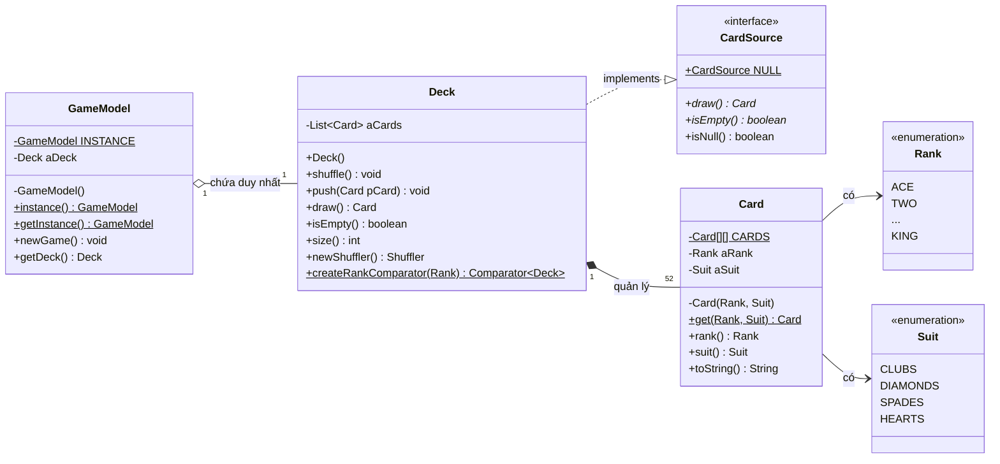

## I. YÊU CẦU ĐỀ BÀI (EXERCISE 9 - CHAPTER 4)
Đề bài yêu cầu:
> *"Using the Singleton Design Pattern, design a GameModel class that is a Singleton. The class should have a single instance variable of type Deck and initialize the deck whenever a newGame() method is called. The class can remain a stub, meaning that it does not need to do anything else."*

**Nội dung trọng tâm cần đạt:**
1. Cài đặt mẫu thiết kế Singleton cho lớp `GameModel`.
2. Khai báo một biến thực thể kiểu `Deck`.
3. Cài đặt phương thức `newGame()` để khởi tạo/tái thiết lập bộ bài khi bắt đầu ván mới.
4. Lớp có thể giữ dạng khung sườn (stub), không cần thêm các logic phức tạp khác.

---

## II. PHÂN TÍCH MÃ NGUỒN VÀ CẤU TRÚC BÀI LÀM

### 1. Lựa chọn phiên bản mã nguồn
Trong repository của môn học có 3 thư mục `code-e1`, `code-e2`, `code-e3` tương ứng với 3 ấn bản của sách giáo trình *"Introduction to Software Design with Java"* (Martin P. Robillard).
- Bài làm lựa chọn sử dụng mã nguồn trong **`code-e3`** (Edition 3 - ấn bản mới nhất năm 2026).
- Lý do: Tài liệu bài tập của chương 4 (`exercises/e-chapter4.md`) liên kết trực tiếp tới các file trong `code-e3` và phiên bản này sử dụng cú pháp Java hiện đại, chuẩn mực hướng đối tượng.

### 2. Danh mục các file trong bài làm
Thư mục gốc của Chapter 4 bao gồm 7 file mã nguồn. Dưới đây là bảng tổng hợp các file và vai trò trong bài làm:

| STT | Tên file | Nguồn gốc | Vai trò / Mô tả |
|:---:|:---|:---:|:---|
| 1 | `Card.java` | File gốc chương 4 | Biểu diễn lá bài bất biến (Flyweight Pattern). |
| 2 | `CardSource.java` | File gốc chương 4 | Interface cung cấp nguồn rút bài (Null Object Pattern). |
| 3 | `Deck.java` | File gốc chương 4 | Lớp quản lý bộ bài 52 lá (`shuffle()`, `draw()`, `isEmpty()`). |
| 4 | `Rank.java` | File gốc chương 4 | Enum định nghĩa 13 thứ hạng quân bài. |
| 5 | `Suit.java` | File gốc chương 4 | Enum định nghĩa 4 chất quân bài. |
| 6 | `Client.java` | File gốc chương 4 | Lớp kiểm thử ban đầu của chương 4 (bổ sung gọi thử nghiệm `GameModel`). |
| 7 | **`GameModel.java`** | **File gốc được sửa** | **File trọng tâm nộp bài:** Cài đặt Singleton, chứa `Deck` và phương thức `newGame()`. |
| 8 | `Exercise09.java` | File bổ sung | File chạy kiểm thử theo đúng cấu trúc lời giải chuẩn của tác giả. |
| 9 | `Exercise09Demo.java` | File bổ sung | Chương trình kiểm thử toàn diện: kiểm tra tính duy nhất, kiểm tra rút bài & `newGame()`, kiểm tra an toàn đa luồng. |
| 10 | `GameModelLazy.java` | File bổ sung | Phiên bản mở rộng minh họa Singleton theo cơ chế Lazy Initialization (Double-Checked Locking). |
| 11 | `run.bat` | File tiện ích | Kịch bản tự động biên dịch UTF-8 và chạy chương trình trên Windows. |

---

## III. NỘI DUNG CHỈNH SỬA MÃ NGUỒN

Để hoàn thành yêu cầu đề bài, em chỉ cần chỉnh sửa duy nhất file **`GameModel.java`**.

### 1. Mã nguồn `GameModel.java` ban đầu (Stub của tác giả):
```java
package e3.chapter4;

/**
 * Stub for a GameModel class that is an application of the Singleton design
 * pattern.
 */
public class GameModel {

	private static final GameModel INSTANCE = new GameModel();

	private GameModel() {}

	public static GameModel instance() {
		return INSTANCE;
	}
}
```

### 2. Mã nguồn `GameModel.java` sau khi chỉnh sửa:
```java
package exercise09;

public class GameModel {

	// 1. Thể hiện tĩnh duy nhất của Singleton
	private static final GameModel INSTANCE = new GameModel();

	// 2. Biến thực thể kiểu Deck theo yêu cầu đề bài
	private final Deck aDeck = new Deck();

	// 3. Constructor private ngăn chặn việc khởi tạo từ bên ngoài
	private GameModel() {}

	// 4. Phương thức tĩnh cung cấp điểm truy cập toàn cục
	public static GameModel instance() {
		return INSTANCE;
	}

	// Alias hỗ trợ chuẩn đặt tên phổ biến
	public static GameModel getInstance() {
		return INSTANCE;
	}

	// 5. Phương thức khởi tạo / xáo lại bộ bài khi bắt đầu ván mới
	public void newGame() {
		aDeck.shuffle();
	}

	// Getter phục vụ kiểm thử trạng thái bộ bài
	public Deck getDeck() {
		return aDeck;
	}
}
```

### 3. Chi tiết các thành phần được thêm vào:
1. `private final Deck aDeck = new Deck();`: Khai báo và khởi tạo biến thực thể `aDeck`. Từ khóa `final` giúp đảm bảo tham chiếu đến đối tượng bộ bài không bị thay đổi ngoài ý muốn trong suốt vòng đời của `GameModel`.
2. `public void newGame() { aDeck.shuffle(); }`: Hiện thực phương thức `newGame()` bằng cách gọi `shuffle()` trên đối tượng `aDeck`.
3. `public Deck getDeck() { return aDeck; }`: Bổ sung getter cho `aDeck` để các lớp kiểm thử có thể kiểm tra trạng thái bộ bài.

---

## IV. GIẢI THÍCH GIẢI PHÁP THIẾT KẾ (SINGLETON PATTERN)

### 1. Mục đích áp dụng Singleton cho `GameModel`
- Trong kiến trúc game đánh bài, `GameModel` đóng vai trò lưu trữ trạng thái cốt lõi của bàn chơi (bộ bài, các lá bài đã rút, điểm số, lượt chơi).
- Nếu không áp dụng mẫu Singleton, các thành phần khác nhau (UI, Controller, Game Logic) có thể vô tình gọi `new GameModel()` tạo ra nhiều thể hiện riêng lẻ. Khi đó, giao diện hiển thị một bộ bài nhưng logic tính điểm lại thao tác trên một bộ bài khác, dẫn đến sai lệch trạng thái dữ liệu.
- Việc áp dụng Singleton đảm bảo hệ thống chỉ tồn tại **duy nhất một thể hiện của `GameModel`** (Single Source of Truth), toàn bộ các thành phần đều truy cập chung một nguồn dữ liệu duy nhất.

### 2. Ba thành phần kỹ thuật cốt lõi
1. **Private Constructor (`private GameModel() {}`)**:
   - Vô hiệu hóa việc các lớp bên ngoài tạo đối tượng bằng toán tử `new`.
   - Giữ toàn quyền kiểm soát việc sinh đối tượng bên trong chính lớp `GameModel`.
2. **Static Field lưu thể hiện duy nhất (`private static final GameModel INSTANCE = new GameModel();`)**:
   - Sử dụng kỹ thuật **Eager Initialization** (khởi tạo sớm). Đối tượng được tạo ngay khi nạp lớp vào máy ảo JVM.
   - Cơ chế nạp lớp của JVM đảm bảo tính **Thread-Safe** ngầm định mà không cần dùng từ khóa `synchronized`, tránh overhead về mặt hiệu năng.
   - Từ khóa `final` đảm bảo tham chiếu `INSTANCE` là bất biến.
3. **Public Static Method (`public static GameModel instance()`)**:
   - Cung cấp điểm truy cập toàn cục cho các đối tượng khác trong toàn bộ ứng dụng thông qua lời gọi tĩnh `GameModel.instance()`.

### 3. Cơ chế khởi tạo bộ bài trong phương thức `newGame()`
- Đề bài yêu cầu: *"initialize the deck whenever a newGame() method is called"*.
- Trong lớp `Deck.java`, phương thức `shuffle()` được hiện thực như sau:
  ```java
  public void shuffle() {
      aCards.clear(); // Xóa sạch các quân bài cũ / đã rút
      for (Suit suit : Suit.values()) {
          for (Rank rank : Rank.values()) {
              aCards.add(Card.get(rank, suit)); // Nạp lại đủ 52 lá bài
          }
      }
      Collections.shuffle(aCards); // Xáo trộn ngẫu nhiên
  }
  ```
- Do đó, gọi `aDeck.shuffle()` đáp ứng chính xác việc tái khởi tạo lại bộ bài đủ 52 lá ban đầu cho ván mới.
- **Ưu điểm thiết kế:** Tái sử dụng đối tượng `Deck` đã cấp phát, tránh việc mỗi lần chơi ván mới lại phải gọi `new Deck()` gây lãng phí bộ nhớ và tạo gánh nặng cho bộ thu gom rác (Garbage Collector).

---

## V. SƠ ĐỒ LỚP UML (CLASS DIAGRAM)



---

## VI. KIỂM THỬ VÀ KẾT QUẢ THỰC NGHIỆM

Chương trình được kiểm thử thông qua lớp `Exercise09Demo.java` với 4 kịch bản cụ thể:

### 1. Kịch bản kiểm thử:
- **Kịch bản 1 (Tính duy nhất):** Lấy 3 tham chiếu `model1`, `model2`, `model3` qua các hàm truy cập và so sánh bằng toán tử `==` cùng `identityHashCode`.
- **Kịch bản 2 (Hoạt động của `newGame`):** Rút thử 5 lá bài từ bộ bài của `model1` (số lượng bài giảm từ 52 về 47), sau đó gọi `model2.newGame()` và kiểm tra lại qua `model1` xem bộ bài đã được phục hồi đủ 52 lá hay chưa.
- **Kịch bản 3 (Đa luồng):** Tạo 10 luồng (threads) chạy đồng thời cùng truy cập `GameModel.instance()` để xác nhận không xảy ra hiện tượng race condition sinh nhiều thể hiện.
- **Kịch bản 4 (Biến thể Lazy):** Kiểm tra tính đúng đắn của phiên bản mở rộng `GameModelLazy`.

### 2. Kết quả chạy thực tế trên Console:
```text
======================================================================
         CHƯƠNG TRÌNH KIỂM THỬ EXERCISE 9: SINGLETON GAMEMODEL        
======================================================================

--- BƯỚC 1: KIỂM CHỨNG TÍNH CHẤT SINGLETON (DUY NHẤT) ---
Lần gọi 1 (GameModel.instance())   : 1482968390
Lần gọi 2 (GameModel.instance())   : 1482968390
Lần gọi 3 (GameModel.getInstance()): 1482968390
Kết quả so sánh (model1 == model2 == model3): true
=> [PASS] Chỉ có DUY NHẤT một thể hiện GameModel được tạo ra.

--- BƯỚC 2: KIỂM CHỨNG HOẠT ĐỘNG CỦA newGame() VÀ BỘ BÀI (DECK) ---
Khởi tạo ván chơi mới bằng model1.newGame().
Số lượng lá bài ban đầu trong bộ bài: 52

Tiến hành rút 5 lá bài từ model1:
  Lá 1: JACK of HEARTS
  Lá 2: SIX of SPADES
  Lá 3: SIX of CLUBS
  Lá 4: FIVE of CLUBS
  Lá 5: FIVE of DIAMONDS
Số lượng lá bài còn lại trong model1: 47

Kiểm tra số lượng lá bài qua biến model2:
Số lượng lá bài nhìn từ model2: 47

Gọi model2.newGame() để bắt đầu ván mới...
Số lượng lá bài trong model1 sau khi model2.newGame(): 52
=> [PASS] newGame() đã tái khởi tạo và xáo đủ 52 lá bài thành công!

--- BƯỚC 3: KIỂM CHỨNG AN TOÀN TRONG MÔI TRƯỜNG ĐA LUỒNG (10 THREADS) ---
Số lượng thể hiện khác nhau được tạo ra bởi 10 threads: 1
=> [PASS] Thread-safety hoàn hảo: Tất cả các luồng nhận cùng một thể hiện duy nhất!

--- BƯỚC 4: KIỂM TRA BIẾN THỂ LAZY INITIALIZATION (GAMEMODELLAZY) ---
lazy1 == lazy2: true
=> [PASS] Biến thể Lazy hoạt động chính xác.

======================================================================
                TẤT CẢ KIỂM THỬ ĐÃ HOÀN TẤT THÀNH CÔNG!               
======================================================================
```

---

## VII. KẾT LUẬN

1. Lớp `GameModel` đã được hoàn thiện đúng theo nguyên lý của mẫu thiết kế Singleton và đáp ứng đầy đủ các yêu cầu của Exercise 9.
2. Mã nguồn được kiểm thử độc lập, đảm bảo tính toàn vẹn trạng thái, an toàn trong môi trường đa luồng và tối ưu hóa việc quản lý bộ nhớ.
