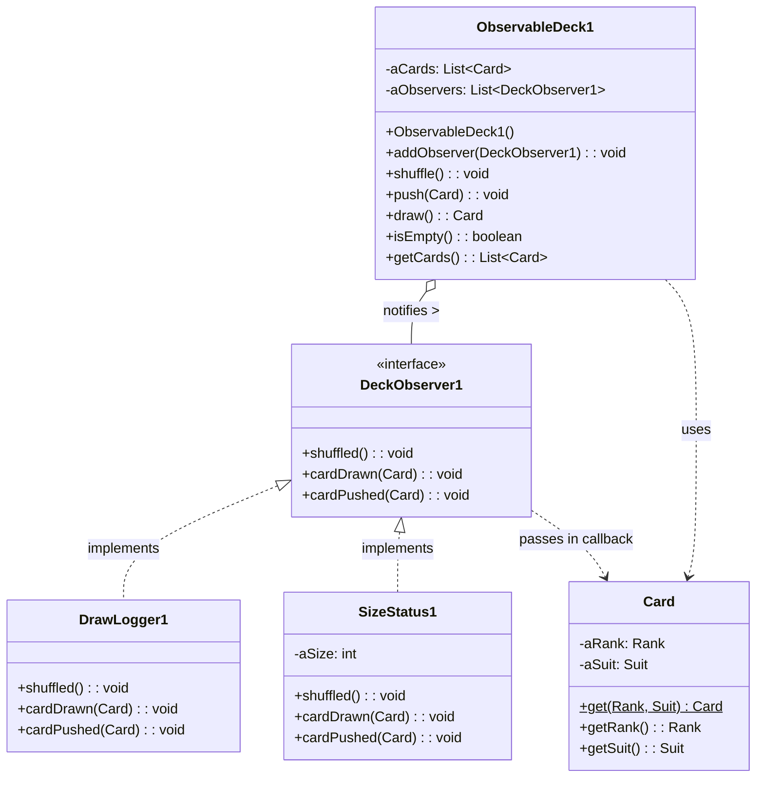
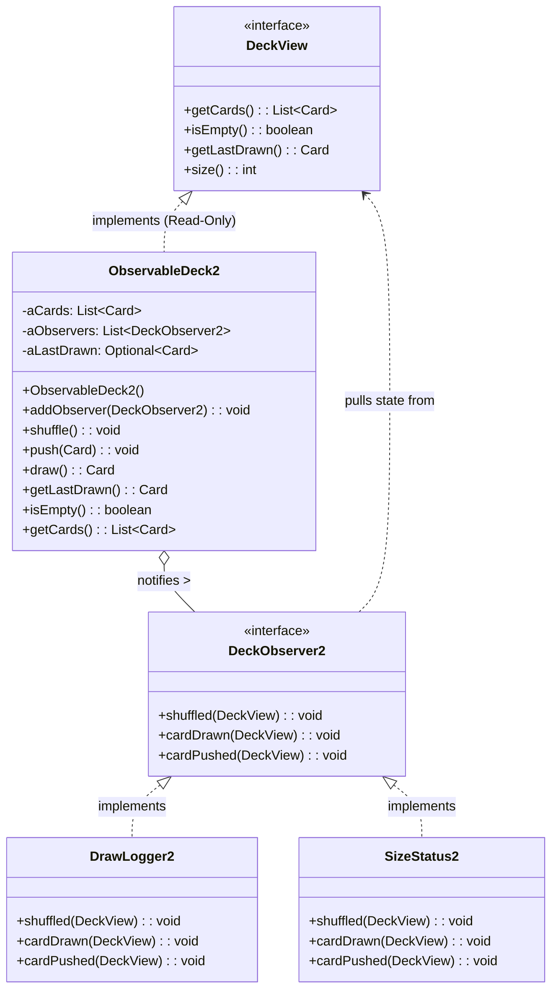
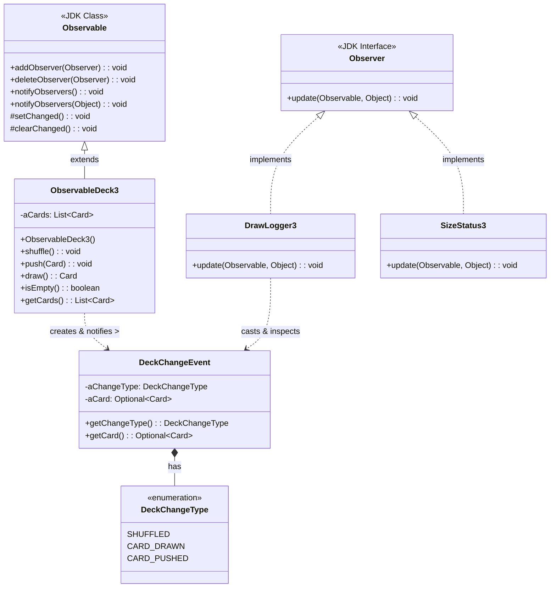
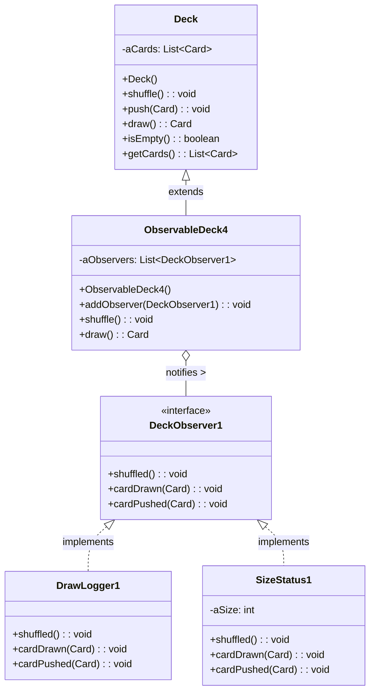

# Báo Cáo Phân Tích & Giải Thích Solutions: Exercise 8.1 - 8.4 (Observer Pattern)

> **Học phần:** Thiết kế phần mềm (Software Design)  
> **Bài tập:** Post-Class 10 — Chuyên đề Mẫu thiết kế Observer (Observer Design Pattern)  
> **Tài liệu tham khảo chính:** *Introduction to Software Design with Java* — Tác giả: Martin P. Robillard (McGill University)  
> **Sinh viên thực hiện:** Trương Văn Khôi  
> **Sản phẩm bàn giao:**  
> - Báo cáo chính thức (.docx): `BaoCao_PostClass10_Observer_Pattern.docx` (định dạng chuẩn học thuật, tích hợp sơ đồ và bảng so sánh)  
> - Tài liệu kỹ thuật Markdown: `README.md` (kèm sơ đồ Mermaid và phân tích kiến trúc chi tiết)  
> - Toàn bộ mã nguồn Java chuẩn: Gói `designbook.chapter8` và `designbook.solutions8`  
> - Scripts tự động hóa: `compile.bat`, `run_all.bat`, `run_all.ps1`  

---

## 📑 Mục lục
1. [Tổng quan về Mẫu thiết kế Observer (Chapter 8)](#1-tổng-quan-về-mẫu-thiết-kế-observer-chapter-8)
2. [Exercise 8.1: Chiến lược Push Data-Flow & Chống Anti-pattern Overfitting](#2-exercise-81-chiến-lược-push-data-flow--chống-anti-pattern-overfitting)
   - [Đề bài & Yêu cầu](#21-đề-bài--yêu-cầu)
   - [Sơ đồ lớp UML giải pháp (Mermaid)](#22-sơ-đồ-lớp-uml-giải-pháp-mermaid)
   - [Phân tích thiết kế và Chống Anti-pattern](#23-phân-tích-thiết-kế-và-chống-anti-pattern)
   - [Mã nguồn và Giải thích chi tiết](#24-mã-nguồn-và-giải-thích-chi-tiết)
3. [Exercise 8.2: Chiến lược Pull Data-Flow & Nguyên lý Phân tách Giao diện (ISP)](#3-exercise-82-chiến-lược-pull-data-flow--nguyên-lý-phân-tách-giao-diện-isp)
   - [Đề bài & Yêu cầu](#31-đề-bài--yêu-cầu)
   - [Sơ đồ lớp UML giải pháp (Mermaid)](#32-sơ-đồ-lớp-uml-giải-pháp-mermaid)
   - [Ứng dụng ISP qua DeckView & Bài toán lưu trữ trạng thái](#33-ứng-dụng-isp-qua-deckview--bài-toán-lưu-trữ-trạng-thái)
   - [Mã nguồn và Giải thích chi tiết](#34-mã-nguồn-và-giải-thích-chi-tiết)
4. [Exercise 8.3: Hỗ trợ Observer thông qua Lớp cha (Superclass: java.util.Observable)](#4-exercise-83-hỗ-trợ-observer-thông-qua-lớp-cha-superclass-javautilobservable)
   - [Đề bài & Yêu cầu](#41-đề-bài--yêu-cầu)
   - [Sơ đồ lớp UML giải pháp (Mermaid)](#42-sơ-đồ-lớp-uml-giải-pháp-mermaid)
   - [Phân tích Ưu điểm & Nhược điểm (Advantages & Disadvantages)](#43-phân-tích-ưu-điểm--nhược-điểm-advantages--disadvantages)
   - [Mã nguồn và Phân tích lý do JDK Deprecation](#44-mã-nguồn-và-phân-tích-lý-do-jdk-deprecation)
5. [Exercise 8.4: Hỗ trợ Observer thông qua Lớp con (Subclass: ObservableDeck extends Deck)](#5-exercise-84-hỗ-trợ-observer-thông-qua-lớp-con-subclass-observabledeck-extends-deck)
   - [Đề bài & Yêu cầu](#51-đề-bài--yêu-cầu)
   - [Sơ đồ lớp UML giải pháp (Mermaid)](#52-sơ-đồ-lớp-uml-giải-pháp-mermaid)
   - [Phân tích Ưu điểm & Cạm bẫy kế thừa (Fragile Base Class & Constructor Issue)](#53-phân-tích-ưu-điểm--cạm-bẫy-kế-thừa-fragile-base-class--constructor-issue)
   - [Mã nguồn và Giải thích chi tiết](#54-mã-nguồn-và-giải-thích-chi-tiết)
6. [Bảng so sánh tổng hợp toàn diện (Comprehensive Comparison Matrix 8.1 - 8.4)](#6-bảng-so-sánh-tổng-hợp-toàn-diện-comprehensive-comparison-matrix-81---84)
7. [Hướng dẫn biên dịch và Thực thi thực tế](#7-hướng-dẫn-biên-dịch-và-thực-thi-thực-tế)

---

## 1. Tổng quan về Mẫu thiết kế Observer (Chapter 8)

Mẫu thiết kế **Observer** (thuộc nhóm Mẫu hành vi — Behavioral Design Patterns) định nghĩa một mối quan hệ phụ thuộc một-nhiều (*one-to-many dependency*) giữa các đối tượng. Khi một đối tượng (gọi là **Subject** hoặc **Observable**) thay đổi trạng thái, tất cả các đối tượng phụ thuộc vào nó (gọi là **Observers**) sẽ được tự động thông báo và cập nhật.

Trong thiết kế phần mềm, Observer Pattern giải quyết hai bài toán sống còn:
1. **Liên kết lỏng (Loose Coupling):** Subject không cần biết cụ thể lớp nào đang quan sát nó; Subject chỉ tương tác thông qua một giao diện trừu tượng (`Observer`).
2. **Tuân thủ nguyên lý Đóng/Mở (Open/Closed Principle - OCP):** Có thể thêm mới bất kỳ Observer nào vào hệ thống trong tương lai mà không cần chỉnh sửa một dòng mã nguồn nào của Subject.

Chuỗi bài tập từ **Exercise 8.1 đến 8.4** trong giáo trình của GS. Martin P. Robillard khai thác sâu 4 chiều không gian thiết kế của mẫu Observer trên mô hình bộ bài (`Deck`):
- **Chiến lược truyền dữ liệu:** Push (Đẩy) vs. Pull (Kéo).
- **Nguyên lý bảo vệ dữ liệu:** Interface Segregation Principle (ISP) để tạo giao diện chỉ đọc (`DeckView`).
- **Chiến lược tổ chức cấu trúc:** Quản lý Observer tại Lớp cha kế thừa (`Superclass`) vs. Lớp con mở rộng (`Subclass`).

---

## 2. Exercise 8.1: Chiến lược Push Data-Flow & Chống Anti-pattern Overfitting

### 2.1. Đề bài & Yêu cầu

> **Đề bài:**  
> Áp dụng mẫu thiết kế Observer để biến lớp `Deck` thành đối tượng có thể quan sát (`ObservableDeck`). Giả định có hai loại observer cụ thể:
> 1. `DrawLogger`: In mô tả của bất kỳ quân bài nào được rút ra khỏi bộ bài.
> 2. `SizeStatus`: In số lượng quân bài còn lại trong bộ bài bất cứ khi nào số lượng này thay đổi.
>
> Thiết kế và cài đặt tất cả các lớp/giao diện cần thiết, đồng thời viết một đoạn mã client nhỏ minh họa hoạt động của mẫu. Sử dụng **chiến lược luồng dữ liệu Push (Push data-flow strategy)**.

### 2.2. Sơ đồ lớp UML giải pháp (Mermaid)



### 2.3. Phân tích thiết kế và Chống Anti-pattern

#### Thách thức thiết kế
Trong đề bài này, Observer `SizeStatus` cần biết kích thước hiện tại của bộ bài để in ra. Lập trình viên thường dễ rơi vào cám dỗ bổ sung tham số kích thước vào callback, ví dụ: `cardDrawn(Card pCard, int pSize)` hoặc bổ sung phương thức `sizeChanged(int pSize)`.

#### Cảnh báo Anti-Pattern từ GS. Martin Robillard: "Overfitting the Observer Interface"
- **Nguyên lý cốt lõi của Observer:** Các phương thức callback trong giao diện `Observer` phải phản ánh **sự thay đổi trạng thái của mô hình (Model's state changes)**, và dữ liệu truyền qua callback phải nhất quán với sự kiện đó.
- **Anti-Pattern:** Việc "ép" (overfit) giao diện `Observer` để phục vụ riêng cho nhu cầu cá biệt của một `ConcreteObserver` nào đó (ở đây là `SizeStatus`) sẽ phá vỡ tính tổng quát của hệ thống, làm ô nhiễm giao diện với các tham số thừa thãi mà các Observer khác (như `DrawLogger`) hoàn toàn không quan tâm.
- **Giải pháp chính tắc:** Giữ giao diện `DeckObserver1` tinh giản, ánh xạ trực tiếp với các hành vi thay đổi trạng thái của bộ bài:
  - `shuffled()`: Bộ bài được xáo trộn lại đầy đủ 52 lá.
  - `cardDrawn(Card pCard)`: Một lá bài được rút ra (đẩy đối tượng `Card` vừa rút).
  - `cardPushed(Card pCard)`: Một lá bài được đặt lên đầu bộ bài (đẩy đối tượng `Card` vừa đặt).
- **Cách xử lý tại `SizeStatus1`:** `SizeStatus1` tự duy trì trạng thái kích thước nội bộ (`aSize`):
  - Khi nhận `shuffled()`: `aSize = 52`.
  - Khi nhận `cardDrawn(Card)`: Nếu `aSize >= 0`, giảm `aSize--` và in ra.
  - Khi nhận `cardPushed(Card)`: Nếu `aSize >= 0`, tăng `aSize++` và in ra.

### 2.4. Mã nguồn và Giải thích chi tiết

```java
// File: src/designbook/solutions8/Exercise01.java
package designbook.solutions8;

import java.util.ArrayList;
import java.util.Collections;
import java.util.List;
import designbook.chapter8.Card;
import designbook.chapter8.Rank;
import designbook.chapter8.Suit;

public class Exercise01 {
    public static void main(String[] args) {
        ObservableDeck1 deck = new ObservableDeck1();
        deck.addObserver(new DrawLogger1());
        deck.addObserver(new SizeStatus1());
        deck.shuffle();
        deck.draw();
        deck.draw();
    }
}

interface DeckObserver1 {
    void shuffled();
    void cardDrawn(Card pCard);
    void cardPushed(Card pCard);
}

class ObservableDeck1 {
    private final List<Card> aCards = new ArrayList<>();
    private final List<DeckObserver1> aObservers = new ArrayList<>();

    public ObservableDeck1() {
        shuffle();
    }

    public void addObserver(DeckObserver1 pObserver) {
        assert pObserver != null;
        aObservers.add(pObserver);
    }

    public void shuffle() {
        aCards.clear();
        for (Suit suit : Suit.values()) {
            for (Rank rank : Rank.values()) {
                aCards.add(Card.get(rank, suit));
            }
        }
        Collections.shuffle(aCards);
        for (DeckObserver1 observer : aObservers) {
            observer.shuffled();
        }
    }

    public void push(Card pCard) {
        assert pCard != null;
        aCards.add(pCard);
        for (DeckObserver1 observer : aObservers) {
            observer.cardPushed(pCard);
        }
    }

    public Card draw() {
        assert !isEmpty();
        Card card = aCards.remove(aCards.size() - 1);
        for (DeckObserver1 observer : aObservers) {
            observer.cardDrawn(card);
        }
        return card;
    }

    public boolean isEmpty() { return aCards.isEmpty(); }
    public List<Card> getCards() { return Collections.unmodifiableList(aCards); }
}

class DrawLogger1 implements DeckObserver1 {
    @Override public void shuffled() {}
    @Override public void cardDrawn(Card pCard) { IO.println(pCard + " drawn"); }
    @Override public void cardPushed(Card pCard) {}
}

class SizeStatus1 implements DeckObserver1 {
    private int aSize = -1;

    @Override
    public void shuffled() {
        aSize = 52;
        IO.println(aSize);
    }

    @Override
    public void cardDrawn(Card pCard) {
        if (aSize >= 0) {
            aSize--;
            IO.println(aSize);
        } else {
            IO.println("Size unknown");
        }
    }

    @Override
    public void cardPushed(Card pCard) {
        if (aSize >= 0) {
            aSize++;
            IO.println(aSize);
        } else {
            IO.println("Size unknown");
        }
    }
}
```

---

## 3. Exercise 8.2: Chiến lược Pull Data-Flow & Nguyên lý Phân tách Giao diện (ISP)

### 3.1. Đề bài & Yêu cầu

> **Đề bài:**  
> Thay đổi thiết kế của lớp `ObservableDeck` từ Bài tập 1 để sử dụng **chiến lược luồng dữ liệu Pull (Pull data-flow strategy)**, đồng thời áp dụng **Nguyên lý Phân tách Giao diện (Interface Segregation Principle - ISP)** nhằm thắt chặt ràng buộc rằng các Observer tuyệt đối không thể làm thay đổi trạng thái của đối tượng `Deck`.

### 3.2. Sơ đồ lớp UML giải pháp (Mermaid)



### 3.3. Ứng dụng ISP qua DeckView & Bài toán lưu trữ trạng thái

#### 1. Áp dụng Interface Segregation Principle (ISP) để bảo vệ trạng thái
- **Nguy cơ tiềm ẩn:** Trong mô hình Pull truyền thống, Subject thường truyền `this` (chính thể hiện của mình) vào callback: `cardDrawn(ObservableDeck pDeck)`. Tuy nhiên, nếu Observer nhận được toàn bộ đối tượng `ObservableDeck`, nó có thể vô tình hoặc cố ý gọi các phương thức mutator như `pDeck.draw()`, `pDeck.shuffle()`, hoặc `pDeck.push()`. Điều này gây ra lỗi biến đổi trạng thái ngoài kiểm soát, thậm chí dẫn đến **vòng lặp đệ quy vô hạn (infinite recursion / stack overflow)** khi callback lại kích hoạt một thông báo mới!
- **Giải pháp ISP:** Tách một giao diện riêng biệt chỉ chứa các phương thức **quan sát / chỉ đọc (Read-Only Interface)** mang tên `DeckView`:
  ```java
  interface DeckView {
      List<Card> getCards();
      boolean isEmpty();
      Card getLastDrawn();
      default int size() { return getCards().size(); }
  }
  ```
- `ObservableDeck2` cài đặt `DeckView`. Nhưng trong callback của `DeckObserver2`, tham số truyền vào **chỉ là kiểu `DeckView`**, hoàn toàn giấu kín các phương thức thay đổi trạng thái (`draw`, `push`, `shuffle`). Observer không thể gọi các hàm làm biến đổi dữ liệu, đảm bảo tính toàn vẹn trạng thái tuyệt đối.

#### 2. Thách thức thông tin lá bài vừa rút (State Retention Challenge)
- Trong mô hình `Deck` thông thường, thao tác `draw()` sẽ gỡ bỏ quân bài khỏi danh sách (`aCards.remove(...)`) và trả về cho caller. Quân bài này không còn nằm trong bộ bài nữa.
- Với mô hình Pull, khi `DeckObserver2` nhận callback, nếu bộ bài không chủ động ghi nhớ quân bài vừa rút thì thông tin này sẽ **vĩnh viễn biến mất** đối với Observer!
- Do đó, `ObservableDeck2` bắt buộc phải thêm trường `private Optional<Card> aLastDrawn = Optional.empty();` để lưu lại lá bài vừa rút mỗi khi gọi `draw()`, và cung cấp getter `getLastDrawn()` trong `DeckView`.
- **Nhận định thiết kế của tác giả:** Thách thức này cho thấy mô hình Pull thuần túy có thể làm phát sinh sự cồng kềnh trong việc lưu trữ trạng thái quá khứ của Subject. Trong thực tế, **kết hợp Push (cho dữ liệu sự kiện cục bộ như quân bài vừa rút) và Pull (cho dữ liệu tổng thể như kích thước bộ bài)** là giải pháp tối ưu nhất (Hybrid Approach).

### 3.4. Mã nguồn và Giải thích chi tiết

```java
// File: src/designbook/solutions8/Exercise02.java
package designbook.solutions8;

import java.util.ArrayList;
import java.util.Collections;
import java.util.List;
import java.util.Optional;
import designbook.chapter8.Card;
import designbook.chapter8.Rank;
import designbook.chapter8.Suit;

public class Exercise02 {
    public static void main(String[] args) {
        ObservableDeck2 deck = new ObservableDeck2();
        deck.addObserver(new DrawLogger2());
        deck.addObserver(new SizeStatus2());
        deck.shuffle();
        deck.draw();
        deck.draw();
    }
}

interface DeckView {
    List<Card> getCards();
    boolean isEmpty();
    Card getLastDrawn();
    default int size() { return getCards().size(); }
}

interface DeckObserver2 {
    void shuffled(DeckView pDeckView);
    void cardDrawn(DeckView pDeckView);
    void cardPushed(DeckView pDeckView);
}

class ObservableDeck2 implements DeckView {
    private final List<Card> aCards = new ArrayList<>();
    private final List<DeckObserver2> aObservers = new ArrayList<>();
    private Optional<Card> aLastDrawn = Optional.empty();

    public ObservableDeck2() { shuffle(); }

    @Override
    public Card getLastDrawn() { return aLastDrawn.get(); }

    public void addObserver(DeckObserver2 pObserver) {
        assert pObserver != null;
        aObservers.add(pObserver);
    }

    public void shuffle() {
        aCards.clear();
        for (Suit suit : Suit.values()) {
            for (Rank rank : Rank.values()) {
                aCards.add(Card.get(rank, suit));
            }
        }
        Collections.shuffle(aCards);
        for (DeckObserver2 observer : aObservers) {
            observer.shuffled(this);
        }
    }

    public void push(Card pCard) {
        assert pCard != null;
        aCards.add(pCard);
        for (DeckObserver2 observer : aObservers) {
            observer.cardPushed(this);
        }
    }

    public Card draw() {
        assert !isEmpty();
        Card card = aCards.remove(aCards.size() - 1);
        aLastDrawn = Optional.of(card);
        for (DeckObserver2 observer : aObservers) {
            observer.cardDrawn(this);
        }
        return card;
    }

    @Override public boolean isEmpty() { return aCards.isEmpty(); }
    @Override public List<Card> getCards() { return Collections.unmodifiableList(aCards); }
}

class DrawLogger2 implements DeckObserver2 {
    @Override public void shuffled(DeckView pDeckView) {}
    @Override public void cardDrawn(DeckView pDeckView) {
        IO.println(pDeckView.getLastDrawn() + " drawn");
    }
    @Override public void cardPushed(DeckView pDeckView) {}
}

class SizeStatus2 implements DeckObserver2 {
    @Override public void shuffled(DeckView pDeckView) { IO.println(pDeckView.size()); }
    @Override public void cardDrawn(DeckView pDeckView) { IO.println(pDeckView.size()); }
    @Override public void cardPushed(DeckView pDeckView) { IO.println(pDeckView.size()); }
}
```

---

## 4. Exercise 8.3: Hỗ trợ Observer thông qua Lớp cha (Superclass: java.util.Observable)

### 4.1. Đề bài & Yêu cầu

> **Đề bài:**  
> Thay đổi thiết kế của lớp `ObservableDeck` từ Bài tập 1 sao cho tất cả các đoạn mã hỗ trợ chức năng Observer được đặt trong một **lớp cha (Superclass)** của Deck. Đánh giá ưu điểm và nhược điểm của quyết định thiết kế này.

### 4.2. Sơ đồ lớp UML giải pháp (Mermaid)



### 4.3. Phân tích Ưu điểm & Nhược điểm (Advantages & Disadvantages)

#### Ưu điểm (Advantages)
1. **Tinh giản mã nguồn trong Subject (`Decluttering`):** Lớp `ObservableDeck3` không còn phải chứa các trường quản lý danh sách Observer (`List<DeckObserver>`), không cần tự viết phương thức `addObserver()`, `removeObserver()`. Mã nguồn trong lớp tập trung hầu hết vào nghiệp vụ bộ bài, chỉ thêm các lệnh kích hoạt `setChanged()` và `notifyObservers(...)`.
2. **Tái sử dụng cơ chế thông báo (`Reusability`):** Toàn bộ cơ chế đăng ký và phát sự kiện được đóng gói sẵn trong lớp cha (`java.util.Observable`), có thể tái sử dụng cho bất kỳ lớp con nào khác trong ứng dụng.
3. **Sử dụng thư viện chuẩn (`Standard Library`):** Không cần tự phát minh lại interface Observer hay các kiểu trừu tượng, tận dụng các kiểu có sẵn trong Java Core.

#### Nhược điểm (Disadvantages - Rất nghiêm trọng)
1. **Lãng phí đặc quyền đơn kế thừa của Java (`Consumes Single Inheritance`):** Java là ngôn ngữ đơn kế thừa lớp (`single class inheritance`). Khi `ObservableDeck3` kế thừa `java.util.Observable`, nó vĩnh viễn mất khả năng kế thừa bất kỳ lớp nghiệp vụ nào khác (ví dụ: không thể kế thừa một lớp cơ sở `CardSource`, `GameComponent`, hay `Deck`).
2. **Mất an toàn kiểu dữ liệu và ép kiểu mong manh (`Brittle Downcasting & Lack of Type Safety`):** Phương thức `update(Observable o, Object arg)` của JDK nhận tham số dạng `Object`. Observer bắt buộc phải ép kiểu cưỡng bức (`(DeckChangeEvent) pEvent`). Nếu Subject vô tình truyền sai kiểu đối tượng (như truyền trực tiếp Enum `DeckChangeType` thay vì đối tượng sự kiện `DeckChangeEvent`), một lỗi ngoại lệ thời gian chạy **`ClassCastException`** sẽ xảy ra ngay lập tức, làm sập chương trình.
3. **Không hỗ trợ callback chuyên biệt (`Lack of Specific Callbacks`):** Mọi sự kiện khác nhau (`shuffled`, `cardDrawn`, `cardPushed`) đều bị dồn chung vào một phương thức `update()`. Lập trình viên bắt buộc phải tự chế ra một hệ thống sự kiện (`DeckChangeEvent` + `DeckChangeType`) và lồng các khối `if-else / switch-case` rườm rà trong từng Observer để lọc sự kiện.
4. **Trùng lặp mã nếu cần phiên bản Non-Observable (`Code Duplication`):** Nếu một module khác cần một đối tượng `Deck` thuần túy không quan sát được (non-observable) để tối ưu hiệu năng bộ nhớ, ta phải sao chép toàn bộ mã nguồn của `Deck` thành một lớp độc lập riêng biệt.

#### Tại sao `java.util.Observable` bị Deprecated từ Java 9?
Do các nhược điểm trí mạng kể trên (không hỗ trợ Generic type-safe, tiêu tốn quyền kế thừa đơn, không serialize tốt, và các vấn đề về đồng bộ đa luồng), Oracle đã chính thức đánh dấu `@Deprecated(since="9")` cho cặp lớp `Observable` / `Observer` và khuyến cáo lập trình viên chuyển sang sử dụng `PropertyChangeListener` (Desktop) hoặc `Flow API` (Reactive Streams).

### 4.4. Mã nguồn và Phân tích kỹ thuật

```java
// File: src/designbook/solutions8/Exercise03.java
package designbook.solutions8;

import java.util.ArrayList;
import java.util.Collections;
import java.util.List;
import java.util.Observable;
import java.util.Observer;
import java.util.Optional;
import designbook.chapter8.Card;
import designbook.chapter8.Rank;
import designbook.chapter8.Suit;

public class Exercise03 {
    public static void main(String[] args) {
        ObservableDeck3 deck = new ObservableDeck3();
        deck.addObserver(new DrawLogger3());
        deck.addObserver(new SizeStatus3());
        deck.shuffle();
        deck.draw();
        deck.draw();
    }
}

enum DeckChangeType { SHUFFLED, CARD_DRAWN, CARD_PUSHED }

class DeckChangeEvent {
    private final DeckChangeType aChangeType;
    private final Optional<Card> aCard;

    public DeckChangeEvent(DeckChangeType pType) {
        aChangeType = pType;
        aCard = Optional.empty();
    }

    public DeckChangeEvent(DeckChangeType pType, Card pCard) {
        aChangeType = pType;
        aCard = Optional.of(pCard);
    }

    public DeckChangeType getChangeType() { return aChangeType; }
    public Optional<Card> getCard() { return aCard; }
}

@SuppressWarnings("deprecation")
class ObservableDeck3 extends Observable {
    private final List<Card> aCards = new ArrayList<>();

    public ObservableDeck3() { shuffle(); }

    public void shuffle() {
        aCards.clear();
        for (Suit suit : Suit.values()) {
            for (Rank rank : Rank.values()) {
                aCards.add(Card.get(rank, suit));
            }
        }
        Collections.shuffle(aCards);
        setChanged();
        notifyObservers(new DeckChangeEvent(DeckChangeType.SHUFFLED));
    }

    public void push(Card pCard) {
        assert pCard != null;
        aCards.add(pCard);
        setChanged();
        notifyObservers(new DeckChangeEvent(DeckChangeType.CARD_PUSHED, pCard));
    }

    public Card draw() {
        assert !isEmpty();
        Card card = aCards.remove(aCards.size() - 1);
        setChanged();
        notifyObservers(new DeckChangeEvent(DeckChangeType.CARD_DRAWN, card));
        return card;
    }

    public boolean isEmpty() { return aCards.isEmpty(); }
    public List<Card> getCards() { return Collections.unmodifiableList(aCards); }
}

@SuppressWarnings("deprecation")
class DrawLogger3 implements Observer {
    @Override
    public void update(Observable pDeck, Object pEvent) {
        if (pEvent instanceof DeckChangeEvent) {
            DeckChangeEvent event = (DeckChangeEvent) pEvent;
            if (event.getChangeType() == DeckChangeType.CARD_DRAWN) {
                IO.println(event.getCard().get() + " drawn");
            }
        }
    }
}

@SuppressWarnings("deprecation")
class SizeStatus3 implements Observer {
    @Override
    public void update(Observable pDeck, Object pEvent) {
        IO.println(((ObservableDeck3) pDeck).getCards().size());
    }
}
```

---

## 5. Exercise 8.4: Hỗ trợ Observer thông qua Lớp con (Subclass: ObservableDeck extends Deck)

### 5.1. Đề bài & Yêu cầu

> **Đề bài:**  
> Thay đổi thiết kế của lớp `ObservableDeck` từ Bài tập 1 sao cho tất cả các đoạn mã hỗ trợ chức năng Observer được đặt trong một **lớp con (Subclass)** của `Deck`. Đánh giá ưu điểm và nhược điểm của quyết định thiết kế này.

### 5.2. Sơ đồ lớp UML giải pháp (Mermaid)



### 5.3. Phân tích Ưu điểm & Cạm bẫy kế thừa (Fragile Base Class & Constructor Issue)

#### Ưu điểm (Advantages)
1. **Không xâm lấn mã nguồn gốc (`Non-invasive`):** Lớp `Deck` ban đầu hoàn toàn sạch sẽ, giữ nguyên tính đóng gói, không hề biết đến sự tồn tại của Observer.
2. **Cung cấp song song cả hai phiên bản không trùng lặp mã (`Dual Availability without Code Duplication`):** Hệ thống có thể dùng `Deck` cho các thuật toán nội bộ hiệu năng cao (không overhead thông báo), và dùng `ObservableDeck4` cho tầng giao diện người dùng (GUI) hoặc ghi log. Cả hai cùng chia sẻ toàn bộ logic xử lý bộ bài từ lớp cha `Deck` mà không cần sao chép mã.
3. **An toàn kiểu dữ liệu và callback chuyên biệt (`Type Safety & Dedicated Callbacks`):** Vẫn sử dụng giao diện tùy biến `DeckObserver1` với các phương thức cụ thể (`shuffled()`, `cardDrawn(Card)`), hoàn toàn không cần ép kiểu `Object` nguy hiểm như Exercise 8.3.
4. **Phân định trách nhiệm rõ ràng (`Separation of Concerns`):** `Deck` quản lý trạng thái nghiệp vụ lá bài; `ObservableDeck4` quản lý việc phát thông báo đến người theo dõi.

#### Nhược điểm & Cạm bẫy kế thừa sâu sắc (Disadvantages & Pitfalls)
1. **Hiểm họa Lớp cơ sở mong manh (`Fragile Base Class Problem`):** Lớp con phụ thuộc chặt chẽ vào việc ghi đè đầy đủ các phương thức làm thay đổi trạng thái của lớp cha. Nếu tương lai lớp cha `Deck` được bổ sung thêm một phương thức mutator (ví dụ: `cut()`, `sort()`, hoặc `dealHand()`) mà người bảo trì lớp con `ObservableDeck4` quên không ghi đè, các thao tác này sẽ âm thầm diễn ra mà **hoàn toàn không kích hoạt bất kỳ thông báo nào đến Observer**, dẫn đến trạng thái Observer bị sai lệch nghiêm trọng.
2. **Cạm bẫy gọi phương thức ghi đè trong Constructor (`Overridable Method in Constructor Pitfall`):**  
   Đây là lỗi kinh điển trong lập trình hướng đối tượng Java (được Martin Fowler và Joshua Bloch cảnh báo trong *Effective Java - Item 19*):
   - Trong Java, khi tạo thể hiện `new ObservableDeck4()`, hàm khởi tạo `super()` của `Deck` sẽ chạy trước tiên.
   - Hàm khởi tạo `Deck()` lại gọi phương thức `shuffle()`.
   - Do cơ chế đa hình động (*Dynamic Method Dispatch*), phương thức `shuffle()` được thực thi lại chính là `ObservableDeck4.shuffle()`.
   - Tại thời điểm này, các thuộc tính của lớp con (cụ thể là danh sách `aObservers`) **chưa hề được khởi tạo** (vẫn mang giá trị `null`).
   - Nếu mã nguồn gọi `for (DeckObserver1 observer : aObservers)`, chương trình sẽ ném ngay lập tức ngoại lệ **`NullPointerException`**!
   - **Giải pháp xử lý:** Trong `ObservableDeck4.shuffle()`, bắt buộc phải có bước kiểm tra phòng thủ:
     ```java
     super.shuffle();
     if (aObservers != null) {
         for (DeckObserver1 observer : aObservers) {
             observer.shuffled();
         }
     }
     ```
3. **Không thể bọc đối tượng đã tồn tại (`Cannot Decorate Existing Instances`):** Kế thừa lớp con chỉ áp dụng khi tạo mới đối tượng (`new ObservableDeck4()`). Nếu hệ thống đã nhận vào một đối tượng `Deck` có sẵn từ bên ngoài, ta không thể biến nó thành `ObservableDeck4` trong thời gian chạy (điều này chỉ có thể thực hiện nếu dùng mẫu Decorator / Wrapper).

### 5.4. Mã nguồn và Giải thích chi tiết

```java
// File: src/designbook/solutions8/Exercise04.java
package designbook.solutions8;

import java.util.ArrayList;
import java.util.List;
import designbook.chapter8.Card;
import designbook.chapter8.Deck;

public class Exercise04 {
    public static void main(String[] args) {
        ObservableDeck4 deck = new ObservableDeck4();
        deck.addObserver(new DrawLogger1());
        deck.addObserver(new SizeStatus1());
        deck.shuffle();
        deck.draw();
        deck.draw();
    }
}

class ObservableDeck4 extends Deck {
    private final List<DeckObserver1> aObservers = new ArrayList<>();

    public void addObserver(DeckObserver1 pObserver) {
        assert pObserver != null;
        aObservers.add(pObserver);
    }

    @Override
    public void shuffle() {
        super.shuffle();
        // Kiểm tra an toàn phòng ngừa trường hợp super() gọi shuffle() trước khi aObservers được khởi tạo
        if (aObservers != null) {
            for (DeckObserver1 observer : aObservers) {
                observer.shuffled();
            }
        }
    }

    @Override
    public Card draw() {
        Card card = super.draw();
        for (DeckObserver1 observer : aObservers) {
            observer.cardDrawn(card);
        }
        return card;
    }
}
```

---

## 6. Bảng so sánh tổng hợp toàn diện (Comprehensive Comparison Matrix 8.1 - 8.4)

| Tiêu chí so sánh | Exercise 8.1 (Push Model) | Exercise 8.2 (Pull Model + ISP) | Exercise 8.3 (Superclass Observable) | Exercise 8.4 (Subclass ObservableDeck) |
| :--- | :--- | :--- | :--- | :--- |
| **Chiến lược luồng dữ liệu** | **Push:** Dữ liệu sự kiện (`Card`) được đẩy trực tiếp qua tham số callback. | **Pull:** Subject truyền giao diện chỉ đọc `DeckView`; Observer tự kéo dữ liệu khi cần. | **Push/Pull lai:** Truyền tham chiếu `Observable` kèm đối tượng sự kiện `DeckChangeEvent`. | **Push:** Kế thừa callback Push của Exercise 1; đẩy trực tiếp dữ liệu qua phương thức ghi đè. |
| **Bảo vệ toàn vẹn trạng thái** | Cao (Observer chỉ nhận dữ liệu, không có tham chiếu Subject). | **Tối ưu nhất:** Nhờ nguyên lý ISP tách `DeckView`, Observer không thể gọi các hàm mutator. | Trung bình (Observer nhận `Observable`, có thể ép kiểu ngược để gọi phương thức nếu không cẩn thận). | Cao (Observer không nắm giữ tham chiếu `Deck`). |
| **Tính an toàn kiểu dữ liệu (Type Safety)** | **Rất cao:** Sử dụng giao diện tùy biến với kiểu tường minh (`Card`). | **Rất cao:** Các hàm trên `DeckView` trả về đúng kiểu (`Card`, `int`). | **Rất thấp:** Phải ép kiểu từ `Object`, dễ dính `ClassCastException` tại thời gian chạy. | **Rất cao:** Tái sử dụng giao diện callback tường minh của Exercise 1. |
| **Sự linh hoạt trong phân cấp kế thừa** | Độc lập (Không phụ thuộc vào cây kế thừa bên ngoài). | Độc lập (Chỉ cài đặt interface `DeckView`). | **Kém nhất:** Tiêu tốn quyền đơn kế thừa duy nhất của Java cho `Observable`. | Tốt (Mở rộng từ lớp nghiệp vụ `Deck`). |
| **Hỗ trợ song song bản Non-Observable** | Không (Chỉ có một lớp `ObservableDeck1`). | Không (Chỉ có một lớp `ObservableDeck2`). | Kém (Phải nhân đôi mã nguồn nếu muốn tạo lớp Deck không có tính năng Observable). | **Tối ưu nhất:** Dùng được cả `Deck` thuần túy lẫn `ObservableDeck4` mở rộng mà không trùng mã. |
| **Rủi ro cạm bẫy thiết kế** | Nguy cơ **Overfitting interface** nếu cố nhồi nhét dữ liệu riêng của từng Observer. | Phải lưu thêm trạng thái quá khứ (`aLastDrawn`) vì dữ liệu rút ra đã biến mất khỏi bộ bài. | Gói sự kiện rườm rà; lớp `java.util.Observable` đã bị JDK Deprecated từ Java 9. | Nguy cơ **Fragile Base Class** và lỗi khởi tạo khi Constructor gọi hàm bị ghi đè. |

---

## 7. Hướng dẫn biên dịch và Thực thi thực tế

### 7.1. Cấu trúc thư mục mã nguồn
```
post-class_10/
├── bin/                                # Thư mục chứa bytecode sau biên dịch
├── images/                             # Sơ đồ lớp UML giải pháp
│   ├── c8-exercise1.png
│   └── c8-exercise2.png
├── src/
│   └── designbook/
│       ├── chapter8/                   # Domain Model cơ sở
│       │   ├── Card.java
│       │   ├── Deck.java
│       │   ├── Rank.java
│       │   └── Suit.java
│       └── solutions8/                 # Các bài giải Exercise 8.1 - 8.4
│           ├── IO.java
│           ├── Exercise01.java
│           ├── Exercise02.java
│           ├── Exercise03.java
│           └── Exercise04.java
├── compile.bat                         # Script biên dịch tự động
├── run_all.bat                         # Script chạy kiểm thử trên CMD
├── run_all.ps1                         # Script chạy kiểm thử trên PowerShell
├── BaoCao_PostClass10_Observer_Pattern.docx # Báo cáo Word chính thức
└── README.md                           # Tài liệu kỹ thuật chi tiết
```

### 7.2. Lệnh biên dịch mã nguồn
```bash
# Biên dịch toàn bộ các lớp trong chapter8 và solutions8
javac -encoding UTF-8 -d bin src/designbook/chapter8/*.java src/designbook/solutions8/*.java
```

### 7.3. Lệnh thực thi từng bài tập
```bash
# Chạy Exercise 8.1 (Push Strategy)
java -cp bin designbook.solutions8.Exercise01

# Chạy Exercise 8.2 (Pull Strategy + ISP DeckView)
java -cp bin designbook.solutions8.Exercise02

# Chạy Exercise 8.3 (Superclass java.util.Observable)
java -cp bin designbook.solutions8.Exercise03

# Chạy Exercise 8.4 (Subclass ObservableDeck extends Deck)
java -cp bin designbook.solutions8.Exercise04
```

### 7.4. Kết quả thực thi thực tế (Console Output)
```
---------------------------------------------------
[1] CHẠY EXERCISE 8.1 (Push Strategy)
---------------------------------------------------
52
THREE of DIAMONDS drawn
51
TEN of SPADES drawn
50

---------------------------------------------------
[2] CHẠY EXERCISE 8.2 (Pull Strategy + ISP DeckView)
---------------------------------------------------
52
FOUR of SPADES drawn
51
FOUR of HEARTS drawn
50

---------------------------------------------------
[3] CHẠY EXERCISE 8.3 (Superclass: java.util.Observable)
---------------------------------------------------
52
51
NINE of CLUBS drawn
50
ACE of SPADES drawn

---------------------------------------------------
[4] CHẠY EXERCISE 8.4 (Subclass: ObservableDeck extends Deck)
---------------------------------------------------
52
JACK of CLUBS drawn
51
SIX of DIAMONDS drawn
50
```

---
*Tài liệu được biên soạn và kiểm chứng hoàn chỉnh theo chuẩn giáo trình "Introduction to Software Design with Java" (Martin P. Robillard).*

