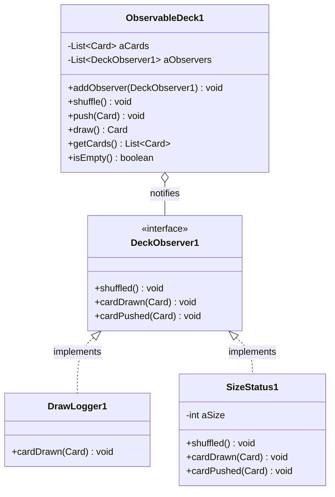
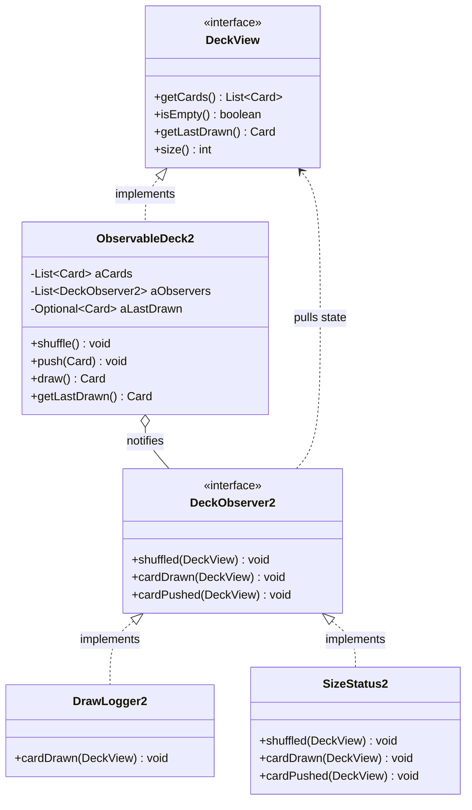
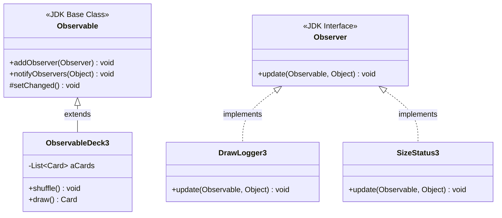
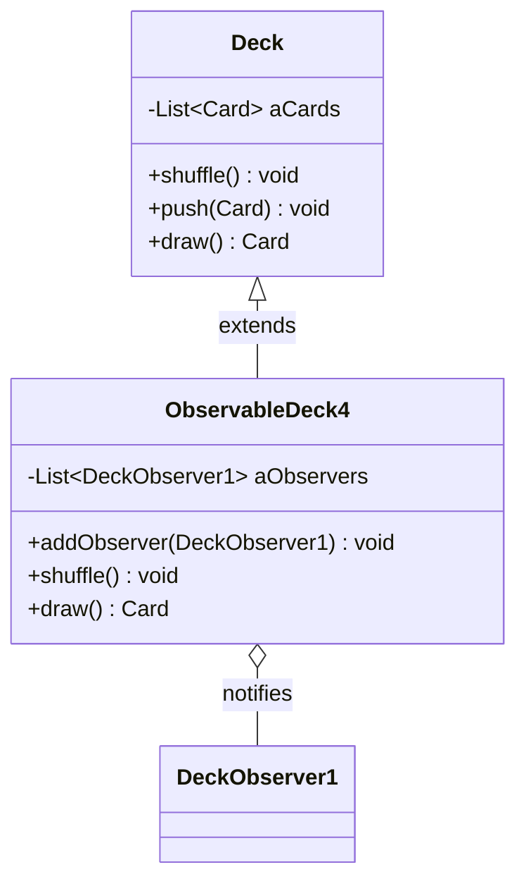

# 🃏 Observer Pattern — Deck Event Notification & Architectural Strategies

[](#)
[-4E79A7?style=flat)](#)
[](#)
[](#)

Triển khai hoàn chỉnh mã nguồn và phân tích kiến trúc chuyên sâu cho mẫu thiết kế **Observer (Mẫu quan sát)**, bao gồm toàn bộ bài tập **Exercise 8.1 đến 8.4** trong Chương 8 giáo trình *Introduction to Software Design with Java* (GS. Martin P. Robillard, Đại học McGill).

---

## 📌 Tổng quan kiến trúc (Architectural Overview)

Dự án khảo sát 4 biến thể thiết kế khi biến một bộ bài chuẩn (`Deck`) thành đối tượng có thể theo dõi sự kiện (`ObservableDeck`):

| Bài tập | Chiến lược thiết kế | Cơ chế chính | Trọng tâm phân tích |
| :--- | :--- | :--- | :--- |
| **Exercise 8.1** | **Push Data-Flow** | Subject chủ động đẩy dữ liệu sự kiện (`Card`) qua hàm callback. | Phòng tránh **Anti-pattern Overfitting Interface** (không nhồi nhét tham số riêng vào interface). |
| **Exercise 8.2** | **Pull Data-Flow & ISP** | Subject truyền giao diện chỉ đọc `DeckView`, Observer tự kéo dữ liệu khi cần. | Ứng dụng **Interface Segregation Principle (ISP)** để ngăn chặn Observer thay đổi trạng thái Subject. |
| **Exercise 8.3** | **Superclass Approach** | Đóng gói logic Observer vào lớp cha `java.util.Observable`. | Đánh đổi quyền đơn kế thừa, rủi ro ép kiểu mong manh (`downcast`) và lý do JDK 9 Deprecation. |
| **Exercise 8.4** | **Subclass Approach** | Kế thừa `ObservableDeck extends Deck` để mở rộng tính năng. | Tối ưu tái sử dụng code, xử lý cạm bẫy **Fragile Base Class** và lỗi khởi tạo Constructor. |

---

## 📁 Cấu trúc thư mục (Repository Structure)

```
post-class_10/
├── bin/                                # Thư mục chứa bytecode sau biên dịch (.class)
├── images/                             # Sơ đồ lớp UML kiến trúc
│   ├── c8-exercise1.png                # Sơ đồ lớp Exercise 8.1 (Push Model)
│   └── c8-exercise2.png                # Sơ đồ lớp Exercise 8.2 (Pull Model + ISP)
├── src/
│   └── designbook/
│       ├── chapter8/                   # Base Domain Model (Bộ bài cơ sở)
│       │   ├── Card.java               # Đối tượng quân bài bất biến (Flyweight pattern)
│       │   ├── Deck.java               # Lớp bộ bài 52 lá nguyên bản
│       │   ├── Rank.java               # Enum cấp bậc bài (ACE .. KING)
│       │   └── Suit.java               # Enum chất bài (CLUBS .. HEARTS)
│       └── solutions8/                 # Các cài đặt Observer Pattern
│           ├── IO.java                 # Tiện ích I/O tương thích đa phiên bản Java
│           ├── Exercise01.java         # Ex 8.1: Push strategy
│           ├── Exercise02.java         # Ex 8.2: Pull strategy + DeckView (ISP)
│           ├── Exercise03.java         # Ex 8.3: java.util.Observable superclass
│           └── Exercise04.java         # Ex 8.4: ObservableDeck subclass
├── compile.bat                         # Script biên dịch tự động (Windows CMD)
├── run_all.bat                         # Script thực thi toàn bộ bài tập (Windows CMD)
├── run_all.ps1                         # Script thực thi trên PowerShell
├── .gitignore                          # Cấu hình bỏ qua bin/, *.class, *.py, ~$*.docx
├── BaoCao_PostClass10_Observer_Pattern.docx # Báo cáo Word học thuật chính thức
└── README.md                           # Tài liệu kỹ thuật dự án (Technical Guide)
```

---

## 🏗️ Phân tích Chi tiết 4 Giải pháp & Sơ đồ UML

### 1. Exercise 8.1: Push Data-Flow & Chống Overfitting Interface
Subject trực tiếp đóng gói và đẩy thông tin sự kiện (`Card`) cho các phương thức callback của Observer.



* **Thách thức:** Observer `SizeStatus1` cần in kích thước bộ bài khi có thay đổi.
* **Anti-Pattern phòng tránh:** Không thêm tham số `size` vào callback (như `cardDrawn(Card, int)` hay `sizeChanged(int)`). Việc bóp méo interface để phục vụ riêng một observer cá biệt sẽ làm hỏng tính tổng quát.
* **Giải pháp chuẩn:** `SizeStatus1` tự duy trì biến đếm nội bộ `private int aSize = -1`. Nhận `shuffled()` thì gán 52; nhận `cardDrawn` thì giảm `aSize--`; nhận `cardPushed` thì tăng `aSize++`.

---

### 2. Exercise 8.2: Pull Data-Flow & Interface Segregation Principle (ISP)
Observer nhận tham chiếu của Subject, nhưng được giới hạn thông qua giao diện chỉ đọc `DeckView`.



* **Bảo vệ toàn vẹn trạng thái bằng ISP:** `DeckView` chỉ cung cấp các hàm quan sát (`getCards()`, `isEmpty()`, `getLastDrawn()`, `size()`). Trình biên dịch ngăn chặn hoàn toàn việc Observer vô tình gọi các hàm mutator (`draw()`, `shuffle()`, `push()`) gây đệ quy vô hạn hoặc hỏng trạng thái.
* **Thách thức lưu trữ trạng thái (State Retention):** Khi `draw()`, lá bài đã bị xóa khỏi danh sách. `ObservableDeck2` buộc phải lưu thêm `private Optional<Card> aLastDrawn` để phục vụ Observer gọi `getLastDrawn()`.

---

### 3. Exercise 8.3: Hỗ trợ Observer thông qua Lớp cha (`java.util.Observable`)
Kế thừa cơ chế quản lý và thông báo Observer từ thư viện chuẩn JDK.



* **Ưu điểm:** Lớp `ObservableDeck3` gọn gàng, không cần tự lưu `List<Observer>` hay viết hàm đăng ký.
* **Nhược điểm & Lý do Deprecated từ Java 9:**
  1. **Tiêu tốn quyền đơn kế thừa duy nhất của Java:** `ObservableDeck3` không thể kế thừa bất kỳ lớp nghiệp vụ nào khác.
  2. **Mất an toàn kiểu dữ liệu (Downcasting Brittle):** Hàm `update(Observable, Object)` nhận `Object`. Bắt buộc phải downcast `(DeckChangeEvent) pEvent`, dễ gây sập chương trình với `ClassCastException`.
  3. **Thiếu callback chuyên biệt:** Phải dồn mọi loại sự kiện vào một hàm `update()` duy nhất và dùng `if-else / switch-case` để phân loại.

---

### 4. Exercise 8.4: Hỗ trợ Observer thông qua Lớp con (`ObservableDeck extends Deck`)
Mở rộng lớp nghiệp vụ `Deck` ban đầu bằng cách kế thừa và ghi đè phương thức thay đổi trạng thái.



* **Ưu điểm:** Lớp `Deck` gốc hoàn toàn không bị xâm lấn; có thể sử dụng song song cả bản thuần túy và bản Observable mà không trùng lặp mã; giữ được callback định kiểu an toàn.
* **Cạm bẫy kế thừa đã được xử lý:**
  1. **Lớp cơ sở mong manh (Fragile Base Class):** Nếu lớp cha bổ sung hàm mutator mới mà lớp con quên override, Observer sẽ bị "mù".
  2. **Cạm bẫy Constructor gọi hàm bị ghi đè:** `Deck()` gọi `shuffle()`. Do đa hình động, hàm `ObservableDeck4.shuffle()` chạy trước khi trường `aObservers` được khởi tạo, dẫn đến `NullPointerException`. Đã được khắc phục bằng bước kiểm tra an toàn:
  ```java
  @Override
  public void shuffle() {
      super.shuffle();
      if (aObservers != null) {
          for (DeckObserver1 observer : aObservers) {
              observer.shuffled();
          }
      }
  }
  ```

---

## ⚖️ Bảng Ma Trận So Sánh Đánh Đổi Kiến Trúc

| Tiêu chí đánh giá | Exercise 8.1 (Push Model) | Exercise 8.2 (Pull + ISP) | Exercise 8.3 (Superclass) | Exercise 8.4 (Subclass) |
| :--- | :--- | :--- | :--- | :--- |
| **Cơ chế truyền dữ liệu** | **Push:** Đẩy trực tiếp `Card` qua tham số callback. | **Pull:** Gửi `DeckView`, Observer chủ động kéo dữ liệu. | **Lai:** Gửi `Observable` kèm đối tượng `DeckChangeEvent`. | **Push:** Kế thừa callback trực tiếp của Ex 8.1. |
| **Bảo vệ toàn vẹn trạng thái** | Cao (Observer chỉ nhận payload, không có tham chiếu Deck). | **Tối ưu nhất:** ISP ẩn triệt để các hàm mutator (`draw`, `push`). | Trung bình (Observer có thể downcast để can thiệp Subject). | Cao (Observer không giữ tham chiếu Deck). |
| **Tính an toàn kiểu (Type Safety)** | **Rất cao** (Định kiểu tường minh với `Card`). | **Rất cao** (Phương thức `DeckView` trả về đúng kiểu). | **Rất kém** (Ép kiểu từ `Object`, dễ dính `ClassCastException`). | **Rất cao** (Tái sử dụng interface định kiểu mạnh). |
| **Độ linh hoạt kế thừa** | Độc lập (Tự đóng gói trong lớp). | Độc lập (Chỉ cài đặt interface `DeckView`). | **Kém nhất** (Tiêu tốn quyền đơn kế thừa duy nhất của Java). | Tốt (Mở rộng từ lớp nghiệp vụ `Deck`). |
| **Hỗ trợ bản Non-Observable** | Cần tạo lớp riêng biệt. | Cần tạo lớp riêng biệt. | Phải nhân đôi toàn bộ code của `Deck`. | **Tối ưu nhất** (Dùng song song `Deck` và `ObservableDeck`). |
| **Rủi ro thiết kế cần xử lý** | Nguy cơ Overfitting interface. | Chi phí lưu vết trạng thái quá khứ (`aLastDrawn`). | JDK Deprecated; code switch-case phân loại sự kiện rườm rà. | Fragile Base Class & lỗi khởi tạo Constructor. |

---

## ⚡ Hướng dẫn Biên dịch & Chạy Thực nghiệm

### Yêu cầu môi trường
- Java Development Kit (JDK 8 trở lên, tương thích hoàn toàn Java 11, 17, 21, 25+).
- Hệ điều hành Windows (hỗ trợ cả Command Prompt và PowerShell).

### 1. Biên dịch toàn bộ dự án
Chạy file script tự động:
```cmd
compile.bat
```
Hoặc biên dịch thủ công qua dòng lệnh:
```bash
javac -encoding UTF-8 -d bin src/designbook/chapter8/*.java src/designbook/solutions8/*.java
```

### 2. Thực thi toàn bộ bài tập cùng lúc
Sử dụng script CMD:
```cmd
run_all.bat
```
Hoặc script PowerShell:
```powershell
.\run_all.ps1
```

### 3. Thực thi từng bài tập riêng biệt
```bash
# Chạy Exercise 8.1 (Push Strategy)
java -cp bin designbook.solutions8.Exercise01

# Chạy Exercise 8.2 (Pull Strategy + ISP DeckView)
java -cp bin designbook.solutions8.Exercise02

# Chạy Exercise 8.3 (Superclass: java.util.Observable)
java -cp bin designbook.solutions8.Exercise03

# Chạy Exercise 8.4 (Subclass: ObservableDeck extends Deck)
java -cp bin designbook.solutions8.Exercise04
```

### Kết quả hiển thị mẫu (Sample Console Output)
```
---------------------------------------------------
[1] CHẠY EXERCISE 8.1 (Push Strategy)
---------------------------------------------------
52
THREE of DIAMONDS drawn
51
TEN of SPADES drawn
50

---------------------------------------------------
[2] CHẠY EXERCISE 8.2 (Pull Strategy + ISP DeckView)
---------------------------------------------------
52
FOUR of SPADES drawn
51
FOUR of HEARTS drawn
50

---------------------------------------------------
[3] CHẠY EXERCISE 8.3 (Superclass: java.util.Observable)
---------------------------------------------------
52
51
NINE of CLUBS drawn
50
ACE of SPADES drawn

---------------------------------------------------
[4] CHẠY EXERCISE 8.4 (Subclass: ObservableDeck extends Deck)
---------------------------------------------------
52
JACK of CLUBS drawn
51
SIX of DIAMONDS drawn
50
```

---

## 📄 Báo Cáo Học Thuật Đính Kèm

Tài liệu báo cáo Word chính thức đã được xuất bản phục vụ nộp bài:
* **Đường dẫn file Word:** [BaoCao_PostClass10_Observer_Pattern.docx](file:///d:/MY%20STUDY/HK1_4/THIET_KE/post-class_10/BaoCao_PostClass10_Observer_Pattern.docx)
* **Quy chuẩn:** Định dạng font Times New Roman, cấu trúc chuẩn mực học thuật, tích hợp sơ đồ lớp UML, hộp chú giải phân tích chuyên sâu và bảng ma trận so sánh.
* **Tác giả:** Trương Văn Khôi.
